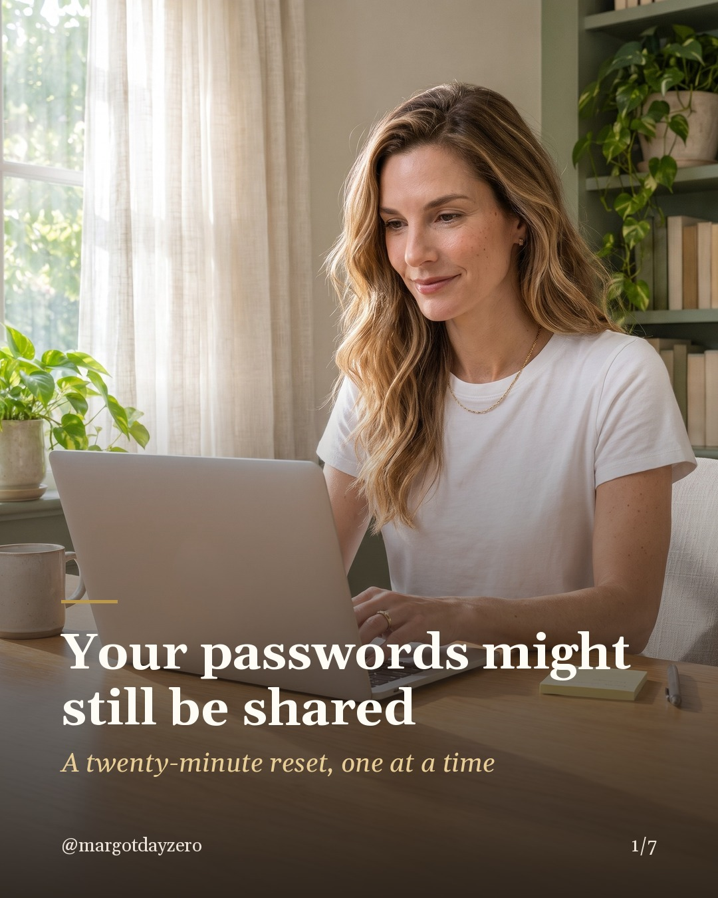
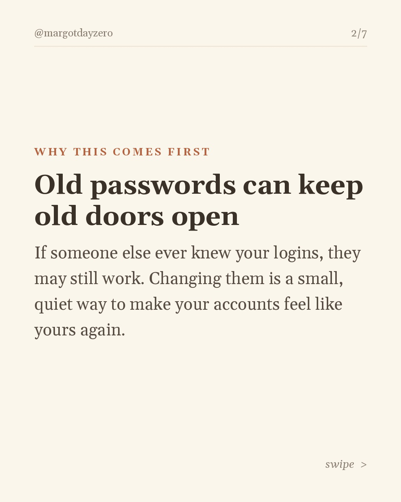
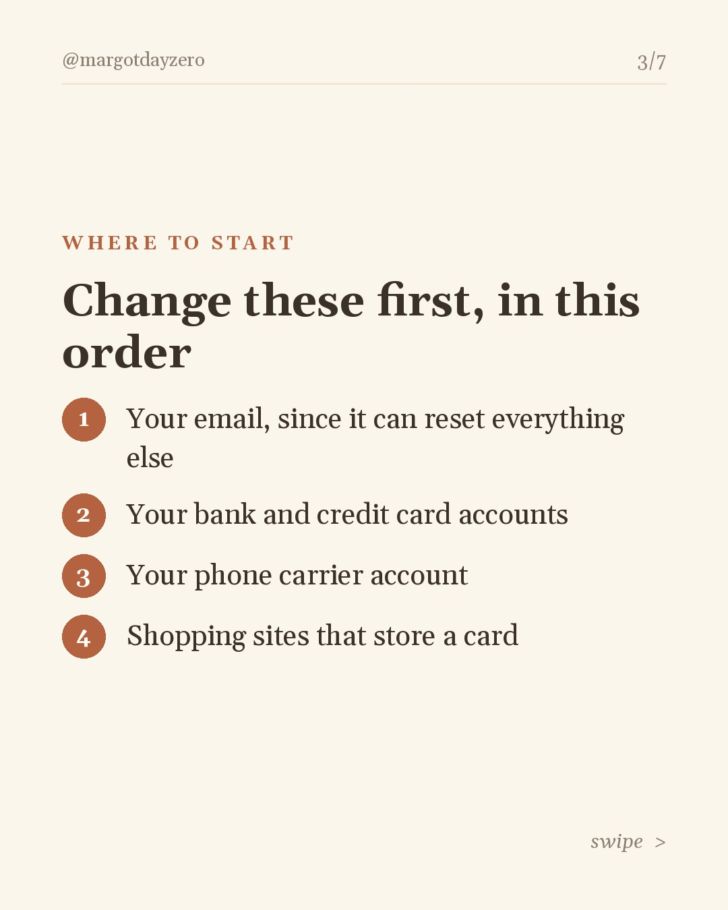
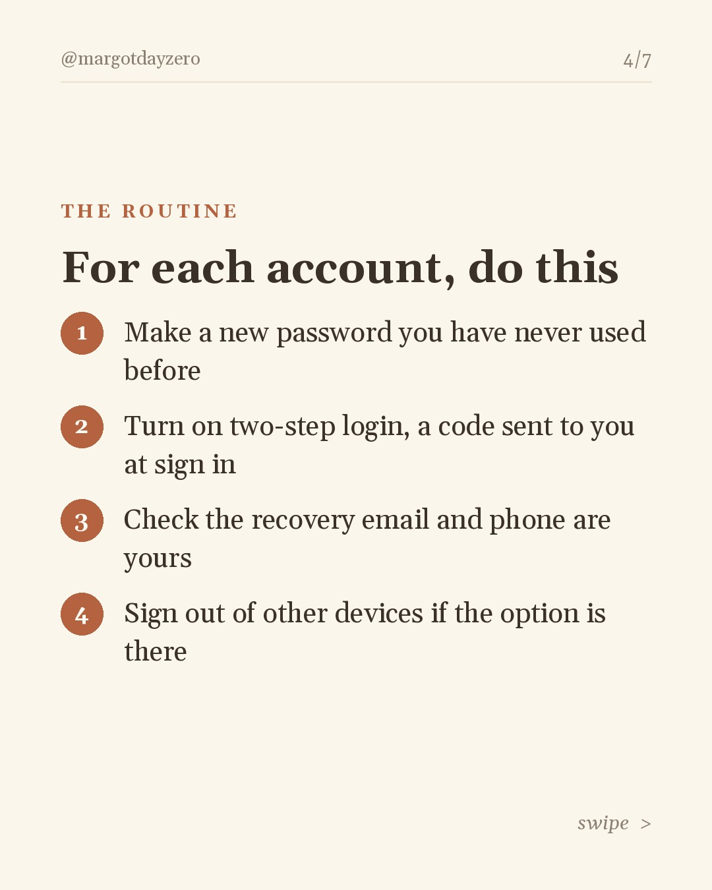
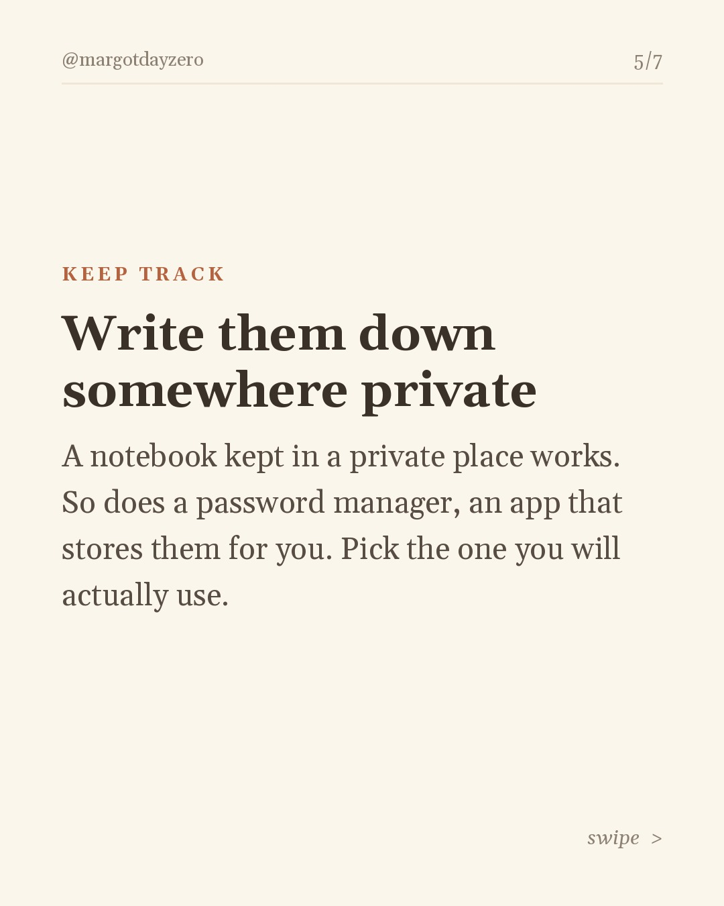
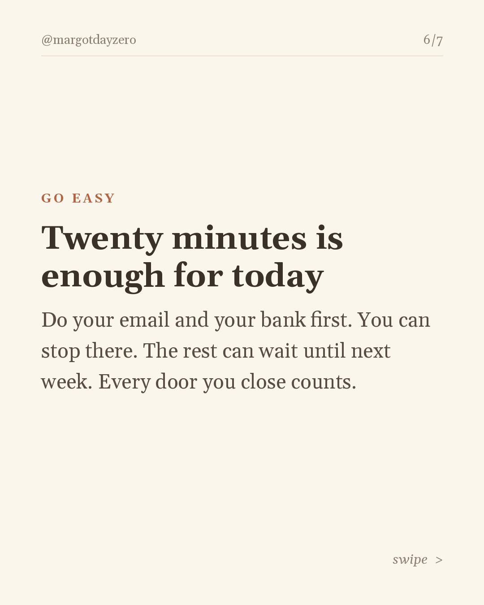
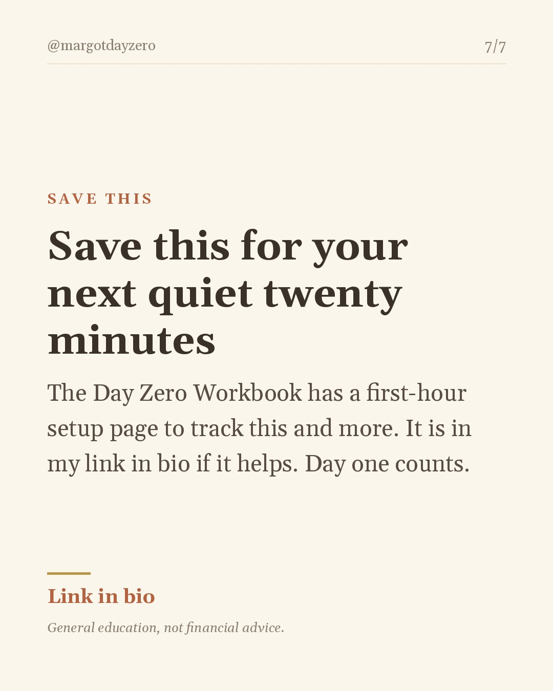

**Scheduled to post Friday, November 13 at 8 AM Eastern.**

To skip it, just **close this issue**. Do nothing and it posts automatically.

**Topic:** Changing your passwords as a first-hour BUILD step after divorce









**Caption:**

```
Small task, big exhale. 🔑

If anyone else ever knew your logins, they might still work.
Start with your email, then your bank.
New password, two-step login, check the recovery info is yours.
Twenty minutes. Stop whenever you need to.

Save this so it is there when you have a quiet moment.

The Day Zero Workbook has a first-hour setup page for this and the other foundations. It is $17, link in bio.

If someone is controlling your money or accounts and you feel unsafe, the National Domestic Violence Hotline is there: 1-800-799-7233.

Day one counts.

General education, not financial advice.

#lifeafterdivorce #divorcedwomen #moneybasics #startingover #financialsafety
```
