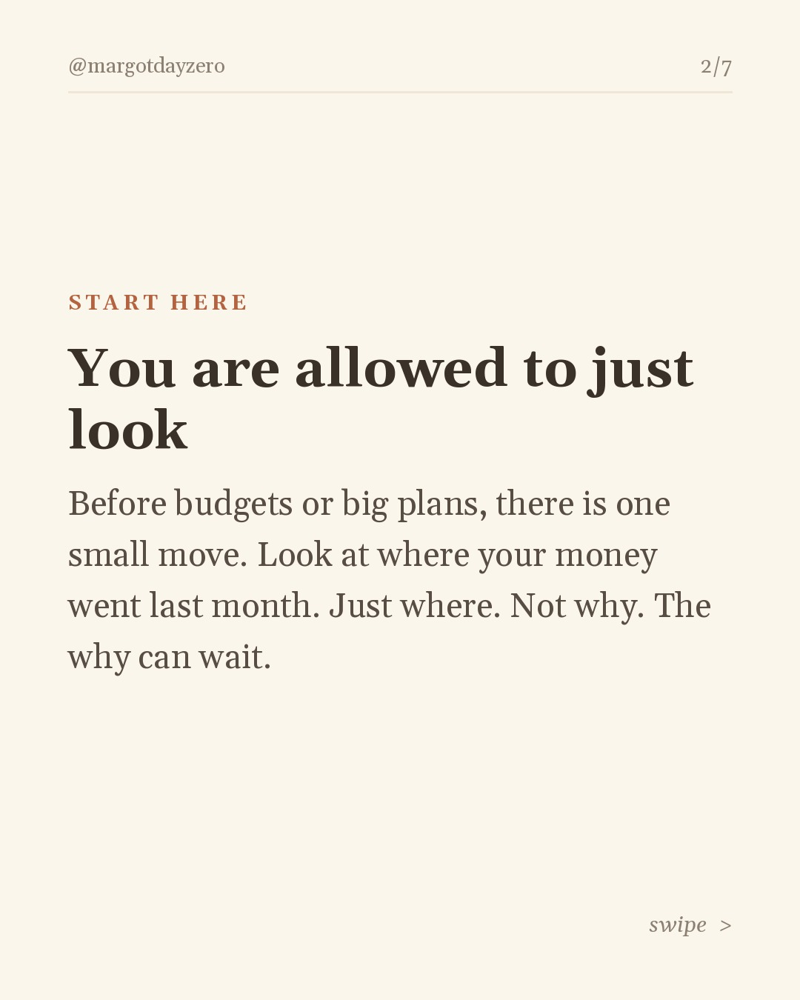
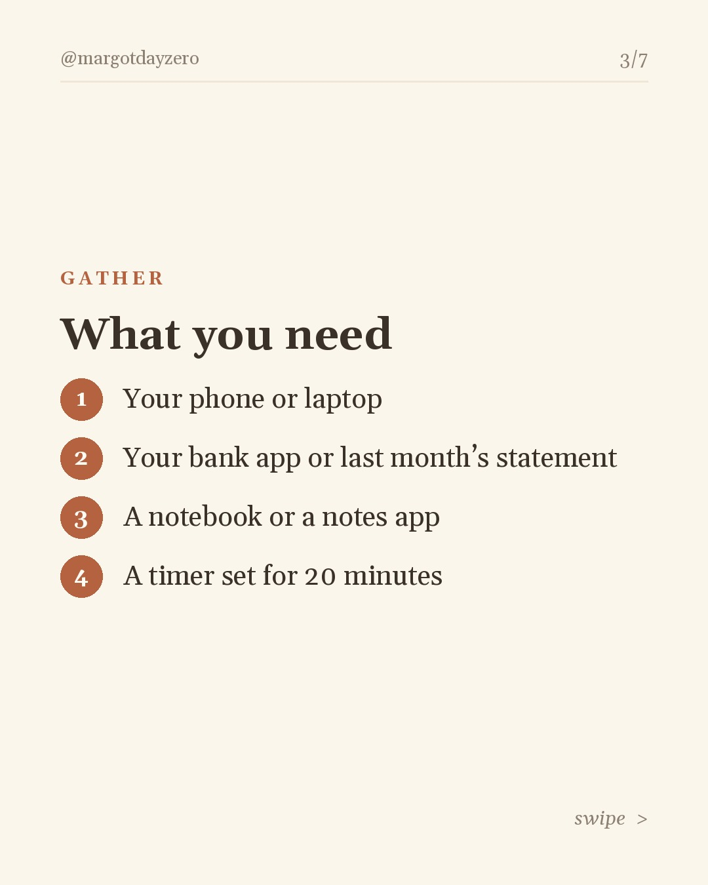
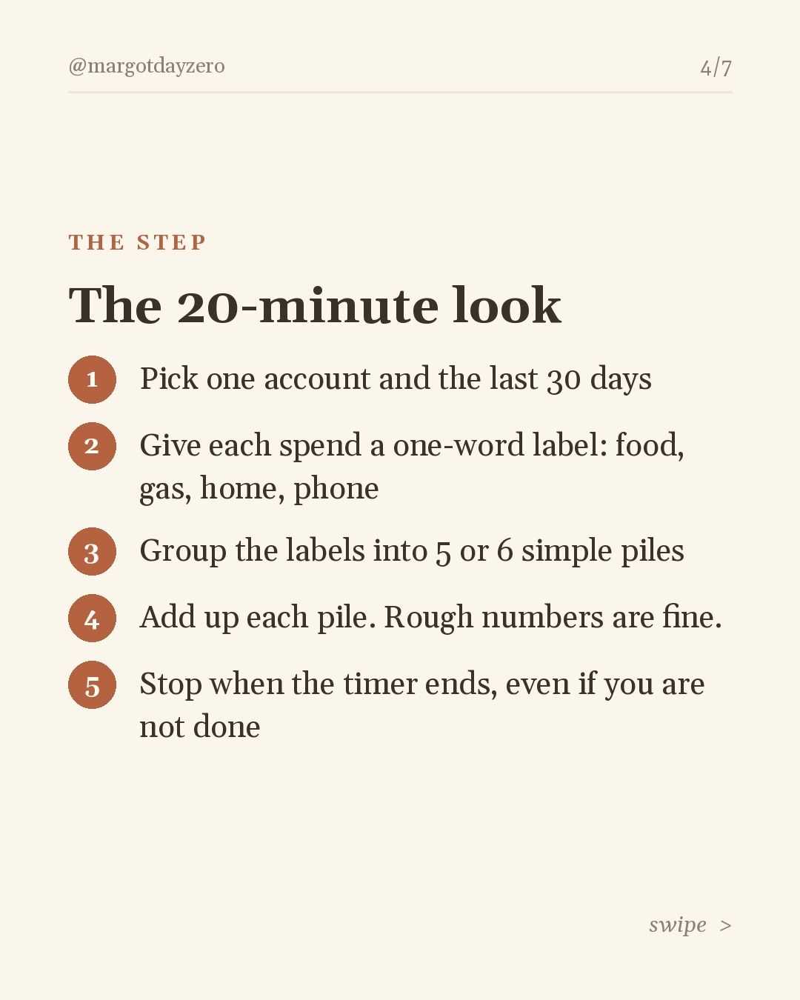
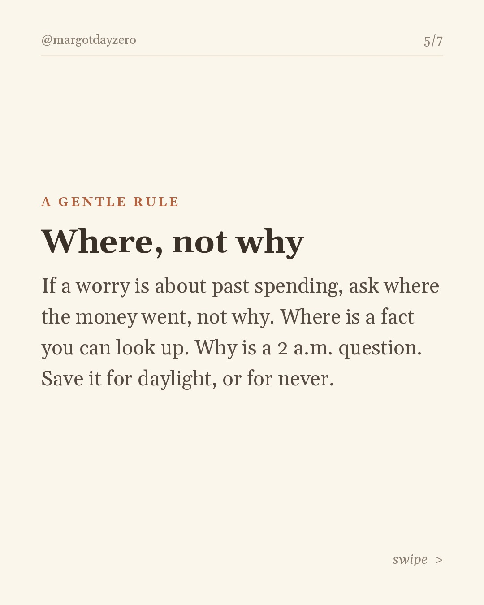
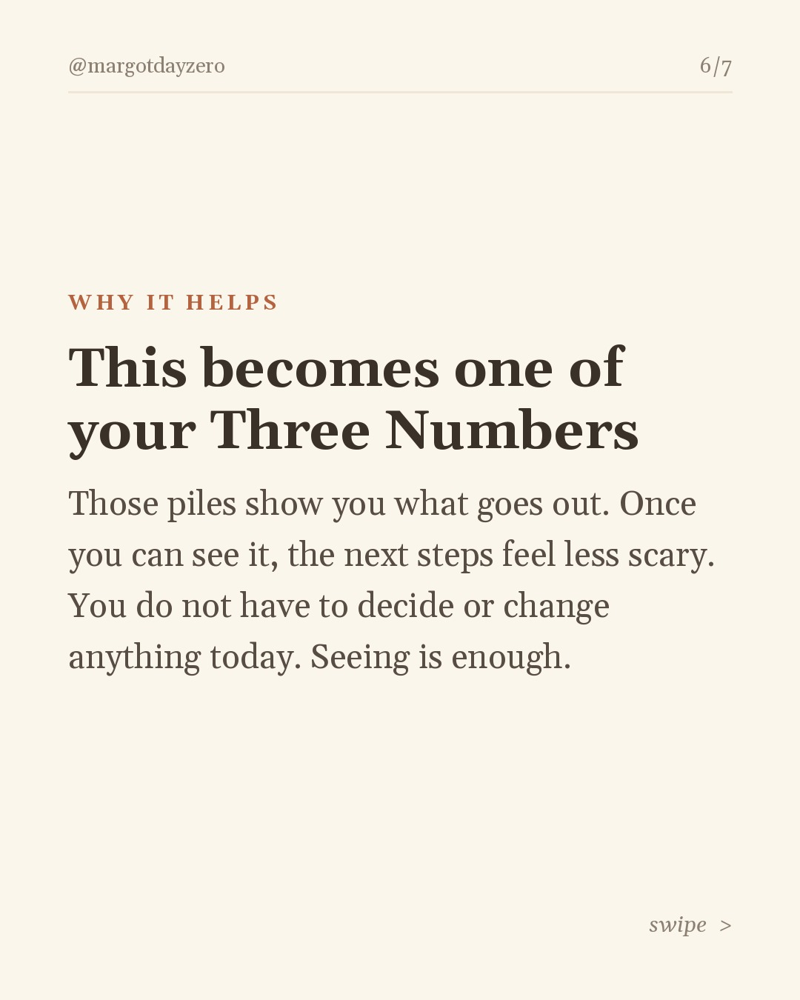

**Scheduled to post Saturday, November 14 at 8 AM Eastern.**

To skip it, just **close this issue**. Do nothing and it posts automatically.

**Topic:** Turning 2 a.m. money worries into a 20-minute daylight worry dump on one page









**Caption:**

```
If the money math only shows up at 2 a.m., this one is for you.
Tomorrow, in daylight, set a timer for 20 minutes.
Write every money worry on one page, one per line, with a number if you know it.
Ask where the money went, not why. Then close the page. That is enough for today.
Save this for the next long night.
When you want a next step, the free Three Numbers Starter Sheet is waiting at the link in bio.
Day one counts.

General education, not financial advice.

#lifeafterdivorce #startingover #moneyanxiety #divorcedwomen #financialfreshstart
```
