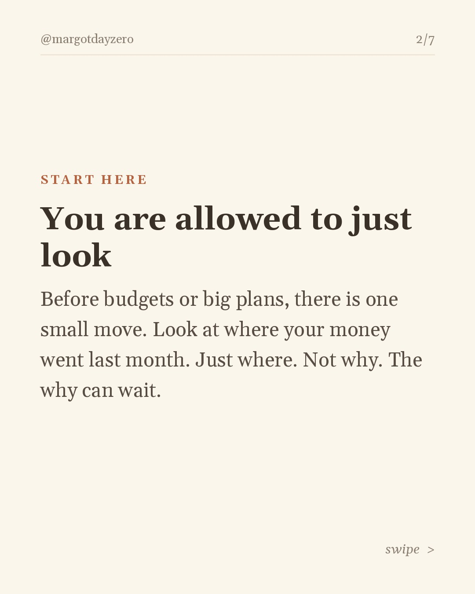
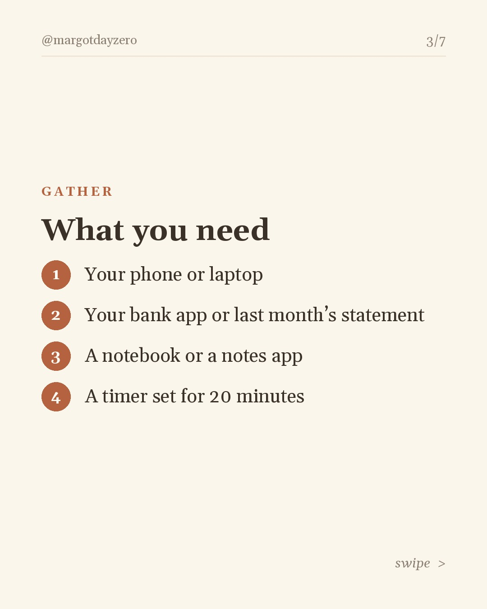
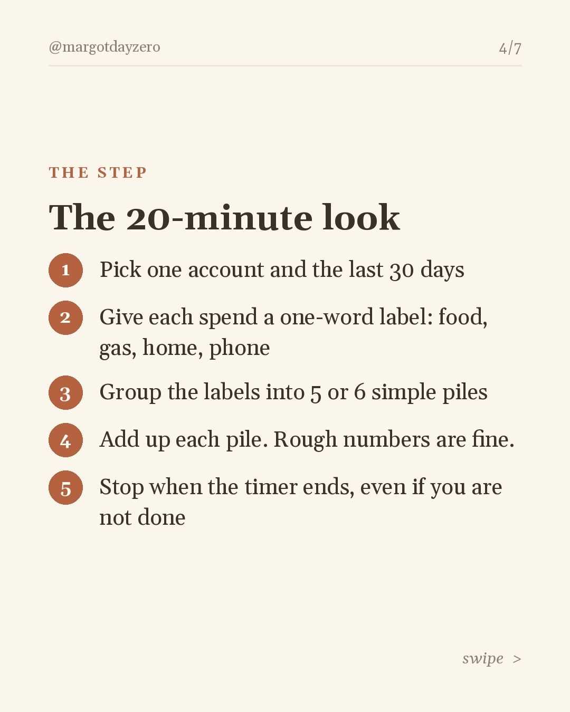
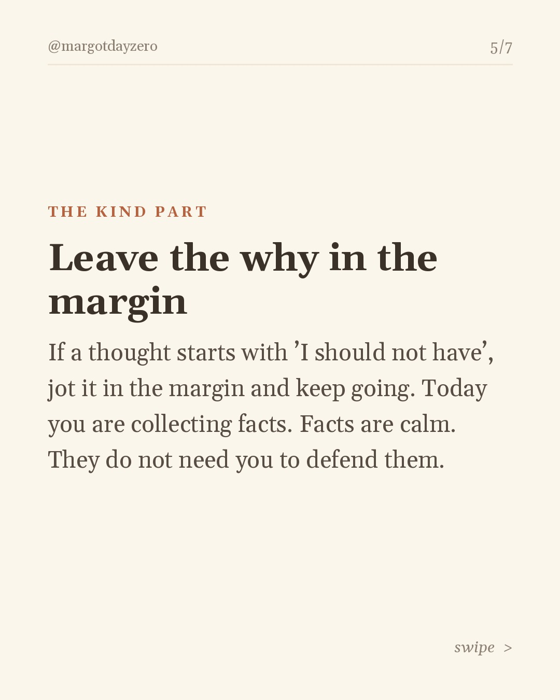
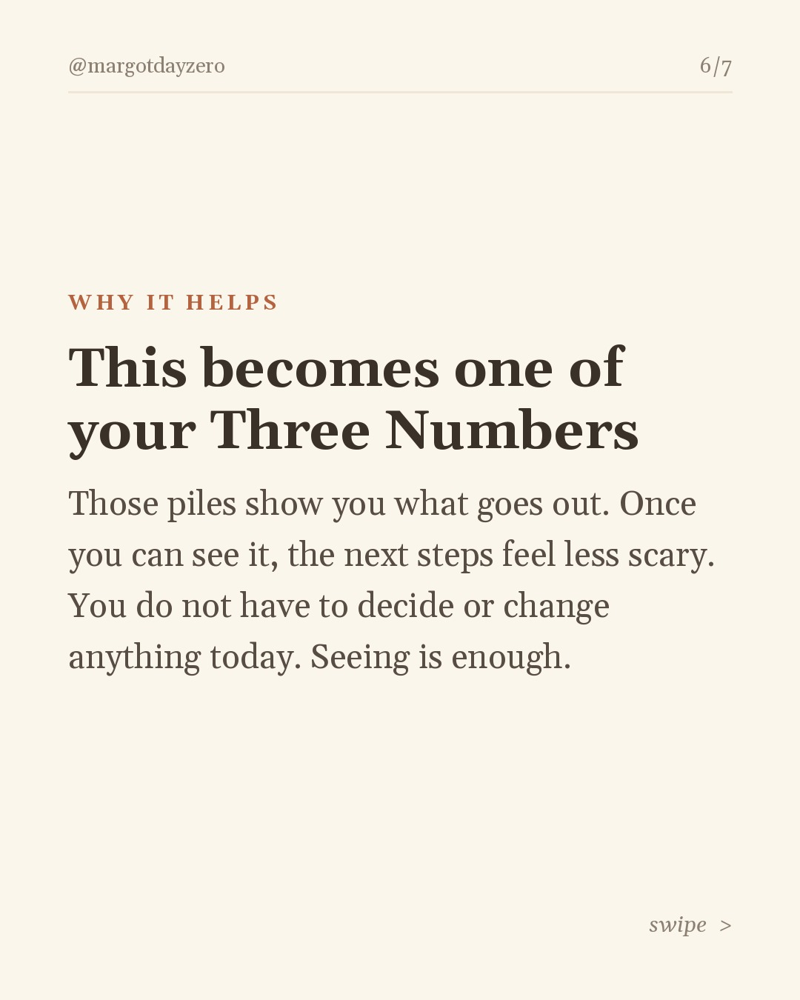
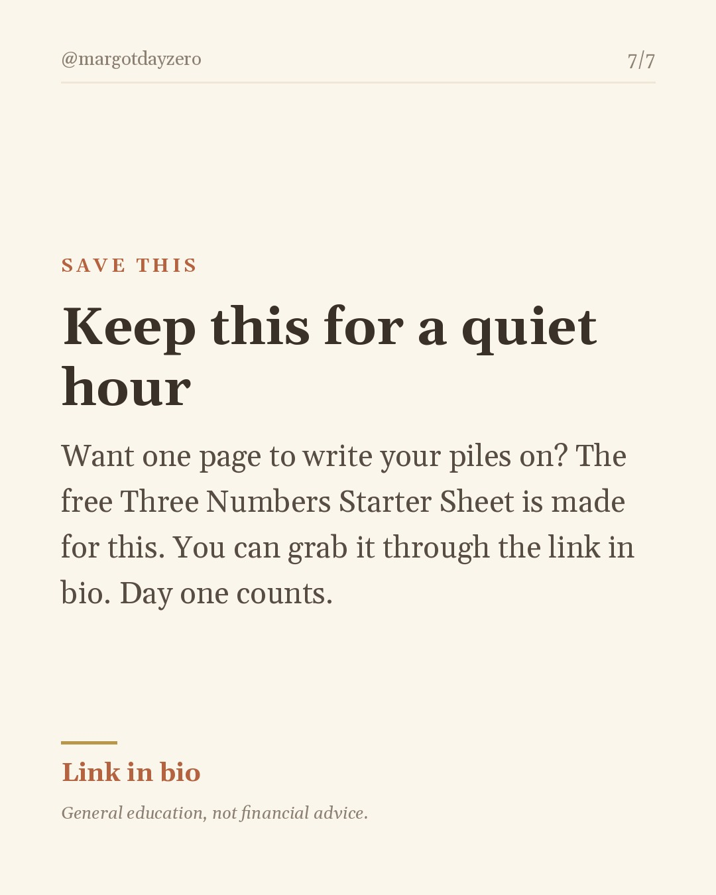

**Scheduled to post Saturday, November 14 at 8 AM Eastern.**

To skip it, just **close this issue**. Do nothing and it posts automatically.

**Topic:** Where did the money go, not why: a calm 20-minute look at last month's spending, sorted into simple piles without judgment









**Caption:**

```
Where did the money go? That is the only question for today.
Not why. Not what you should have done.
Open your bank app, take the last 30 days, and give each spend a one-word label.
Group them into a few piles, add them up roughly, and stop when 20 minutes are up.
Save this for a quiet hour this week.
If you want one page to write it all down, the free Three Numbers Starter Sheet is at the link in bio.
Day one counts.

General education, not financial advice.

#lifeafterdivorce #startingover #moneybasics #divorcedwomen #financialfirststeps
```
