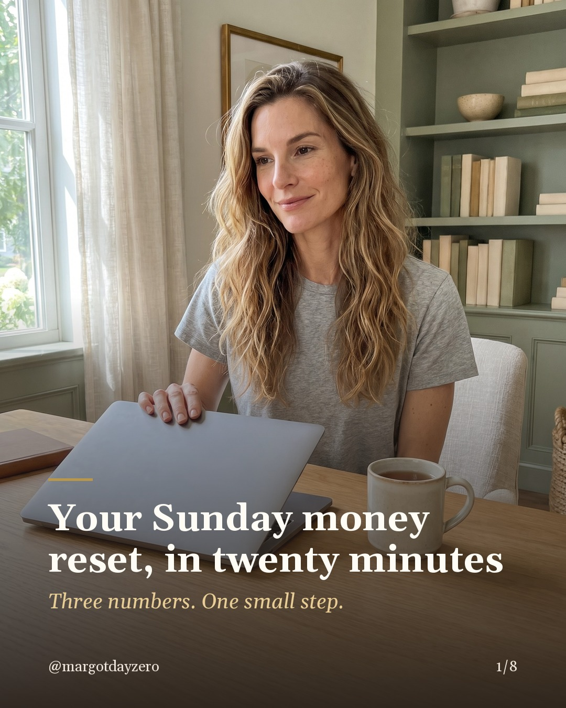
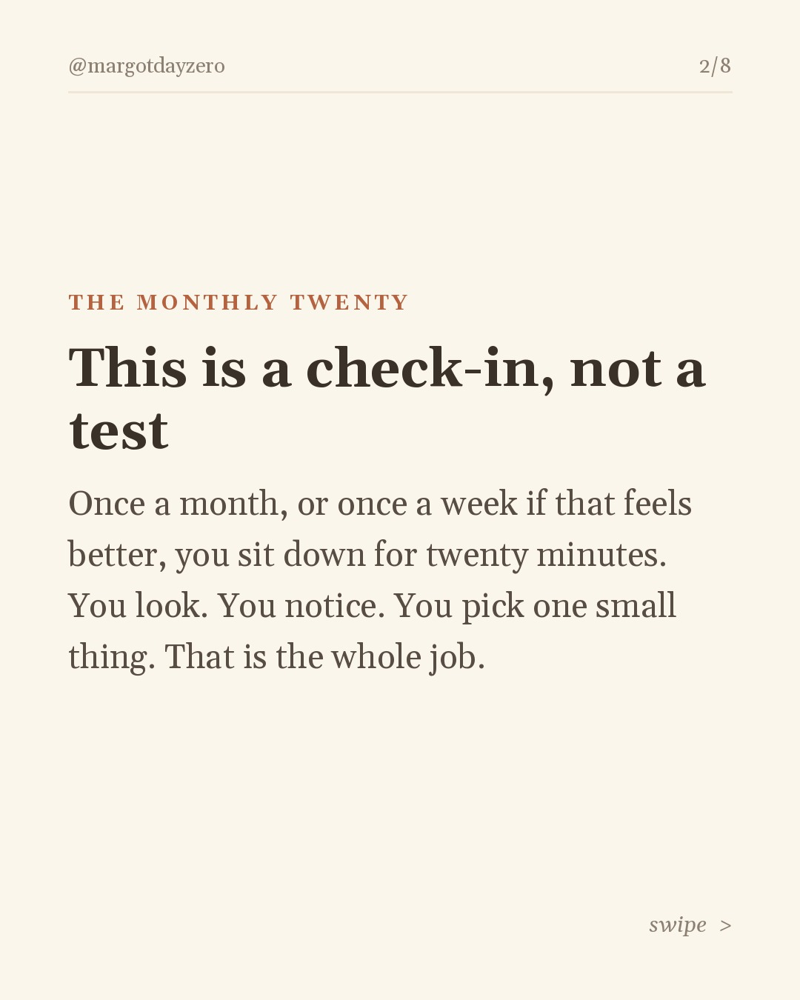
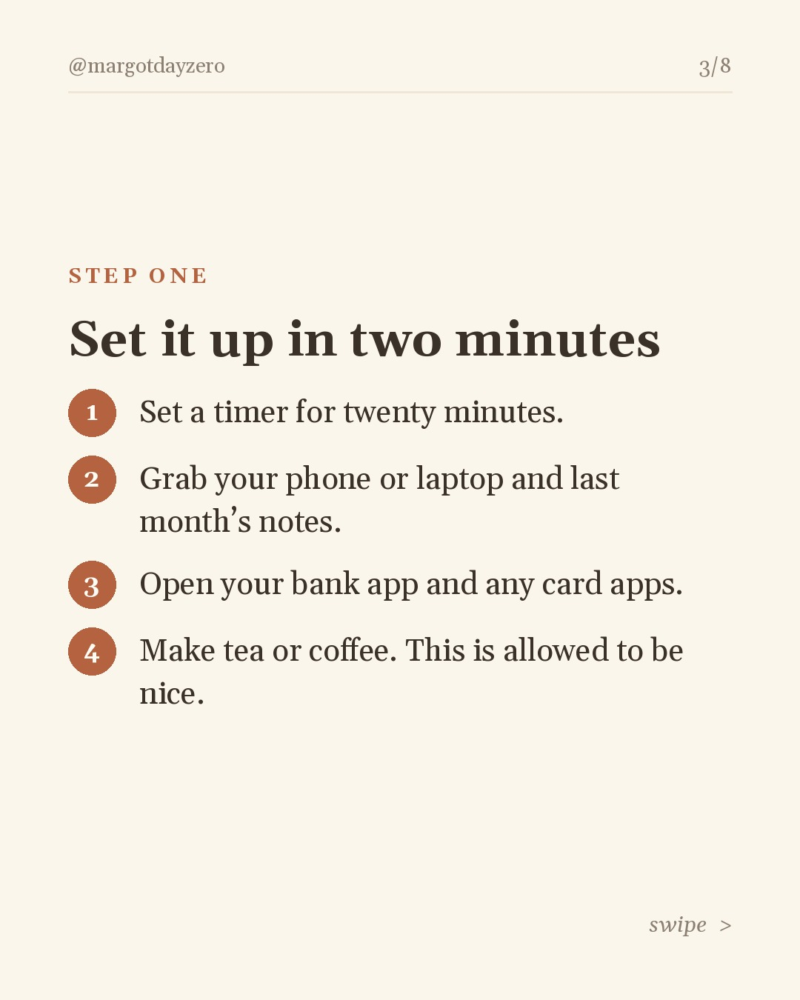
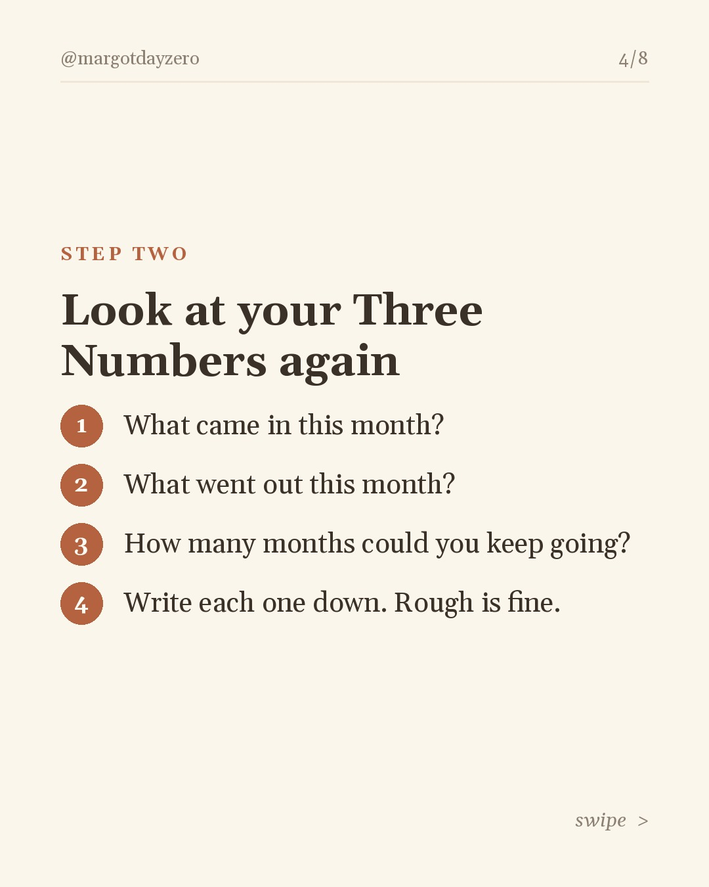
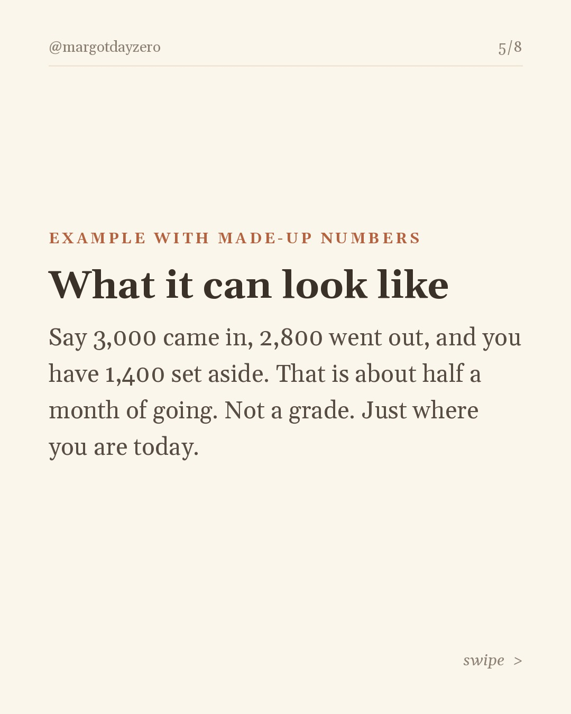
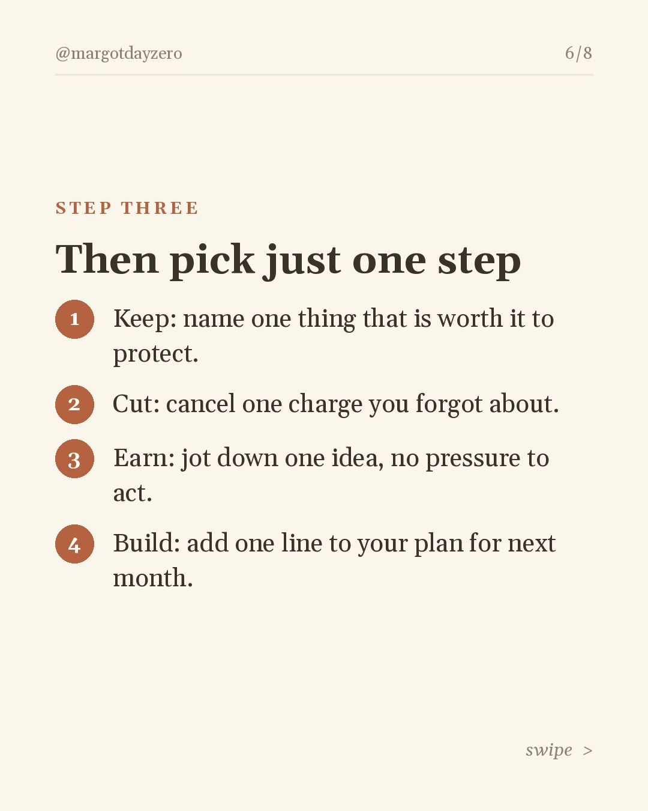
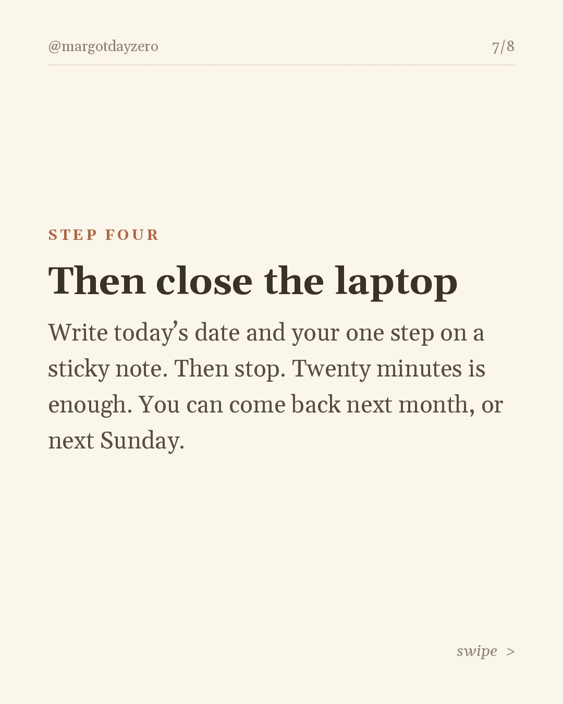
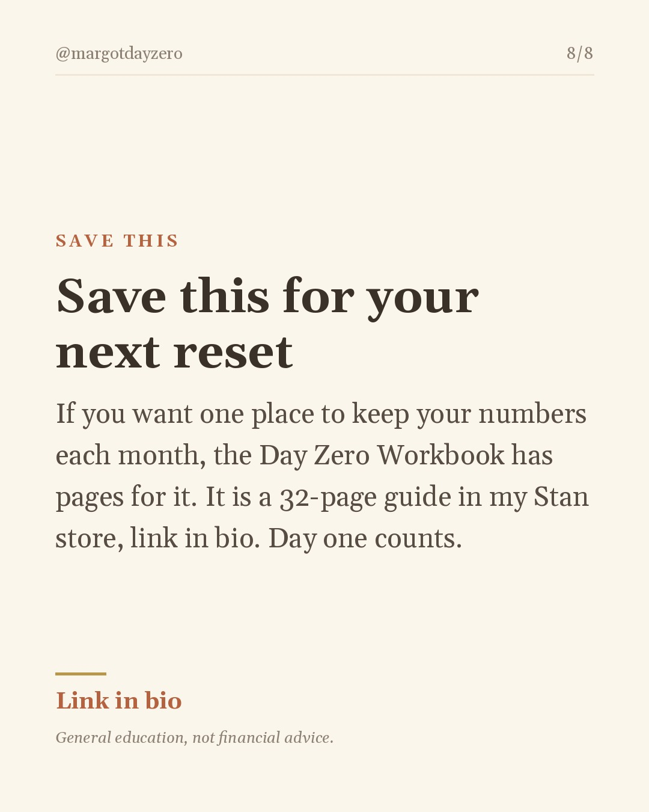

**Scheduled to post Sunday, November 15 at 8 AM Eastern.**

To skip it, just **close this issue**. Do nothing and it posts automatically.

**Topic:** The Monthly Twenty: a calm 20-minute Sunday reset to look at your Three Numbers again and pick one small step










**Caption:**

```
Sunday is a good day to look, not judge. ☕
Set a timer for twenty minutes.
Check your Three Numbers again: what came in, what went out, how many months you could keep going.
Then pick one small step from Keep, Cut, Earn or Build. Just one.
Save this so it is here next Sunday.
If you want a place to track it month to month, the Day Zero Workbook is in my Stan store, link in bio.
Day one counts.

General education, not financial advice.

#lifeafterdivorce #moneyreset #sundayreset #startingover #budgetingforbeginners
```
