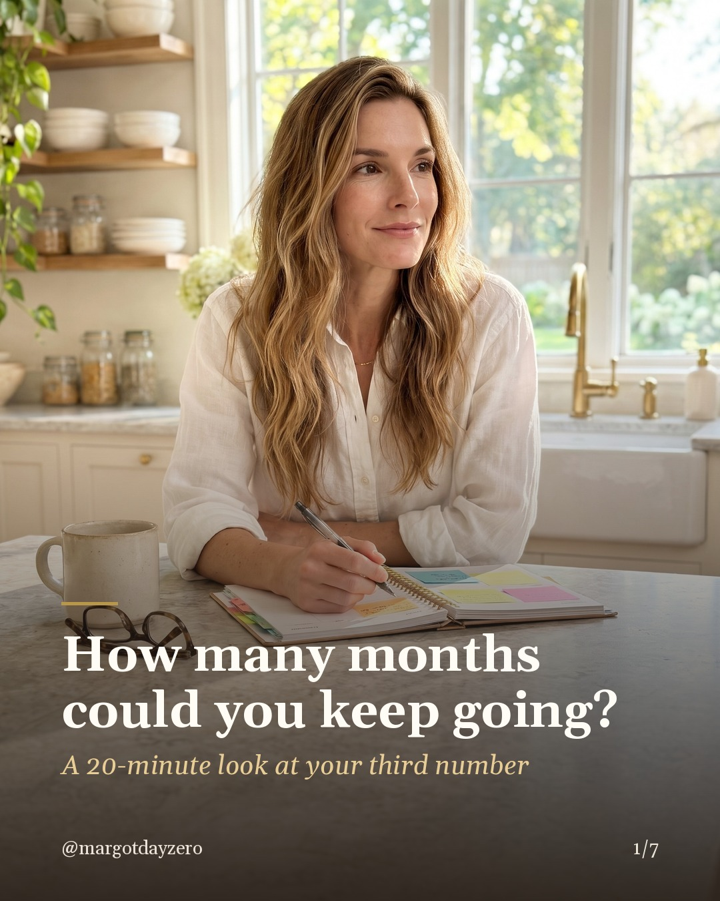
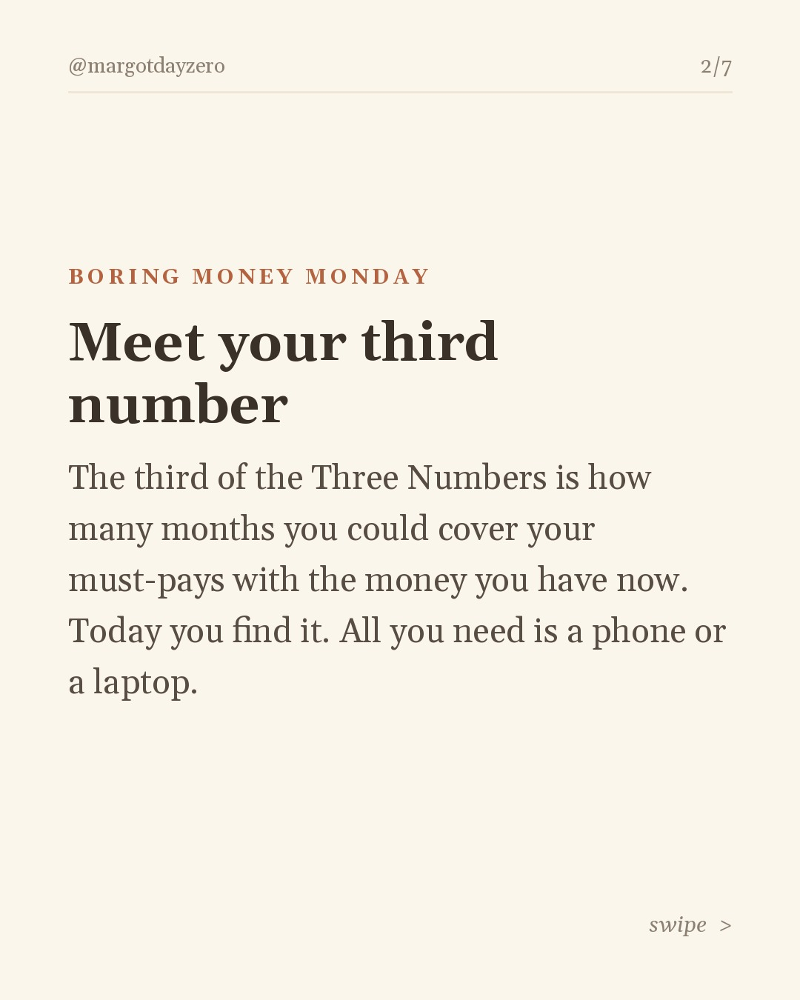
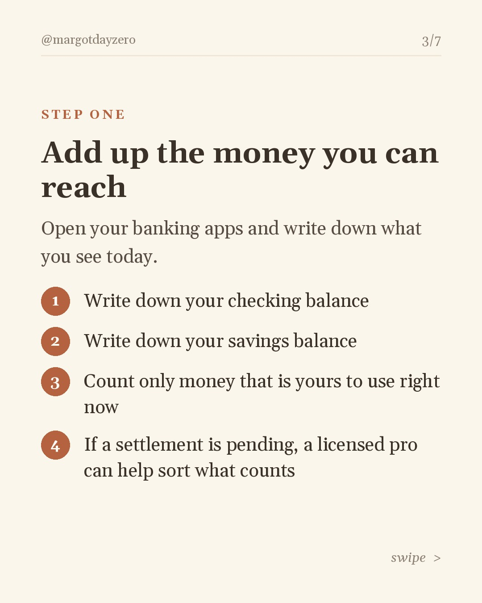
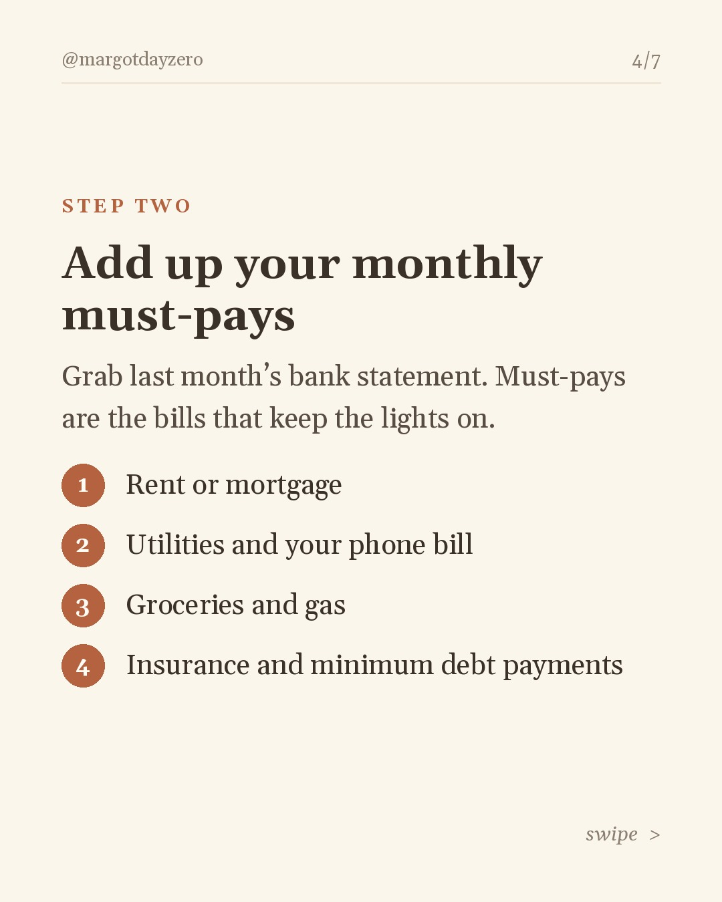
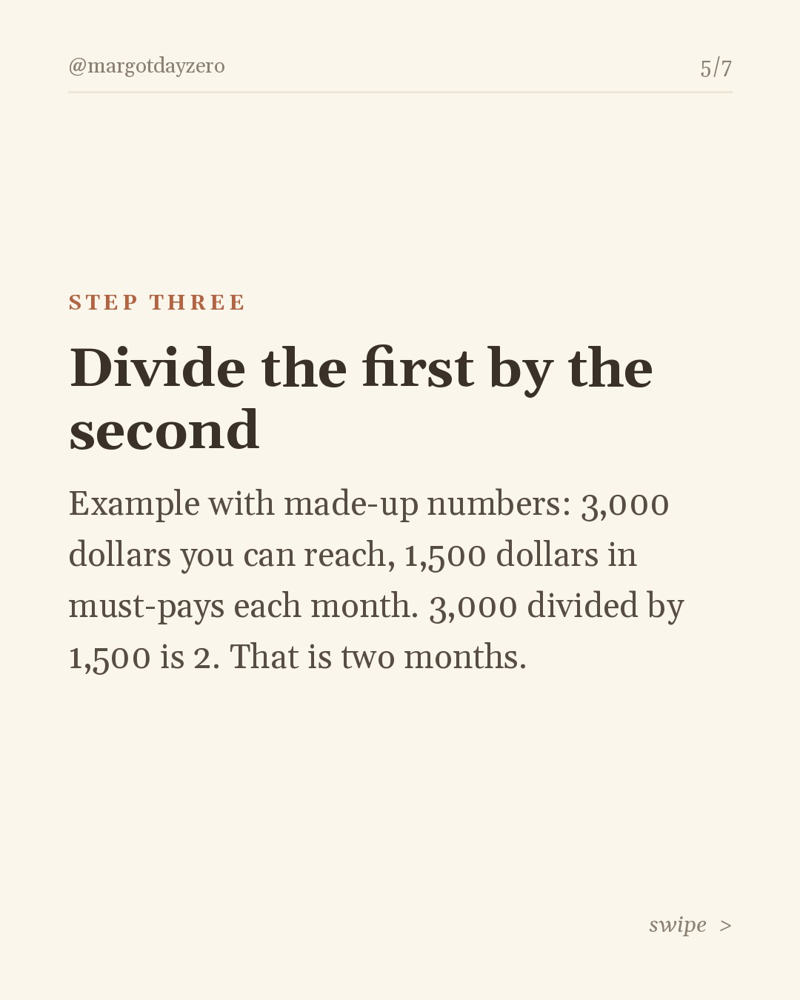
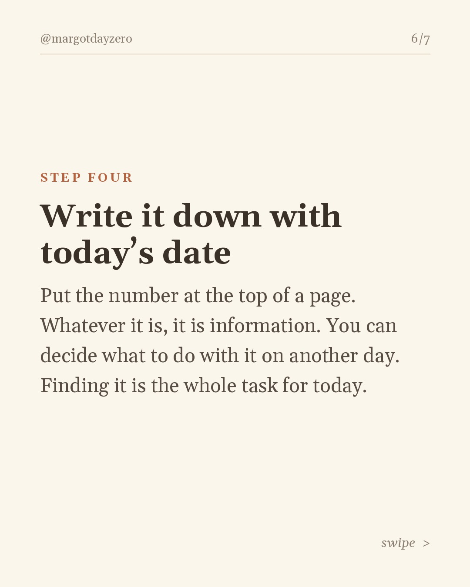
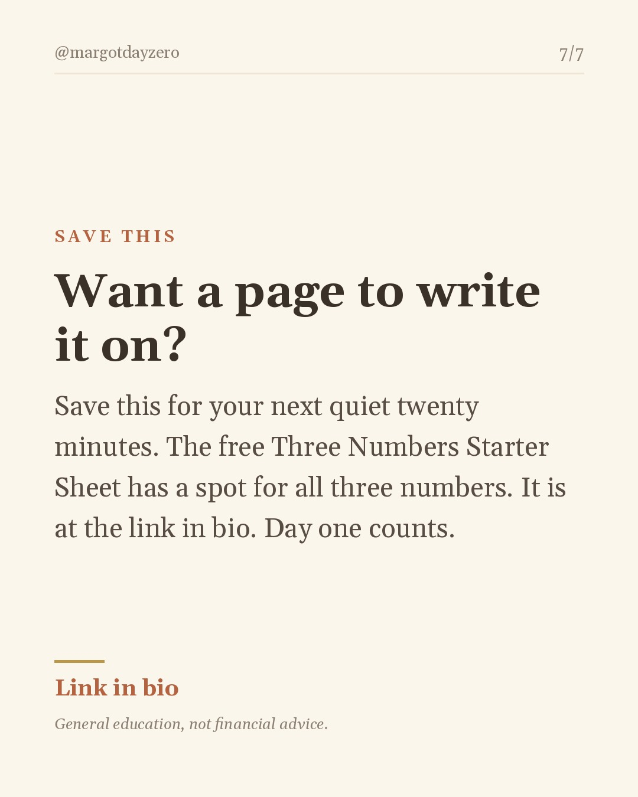

**Scheduled to post Monday, November 16 at 8 AM Eastern.**

To skip it, just **close this issue**. Do nothing and it posts automatically.

**Topic:** Finding your third number: how many months you could cover your must-pays with the money you can reach today









**Caption:**

```
How many months could you keep going? That is your third number, and you can find it today.
Add up the money you can reach right now.
Add up your monthly must-pays from last month's statement.
Divide the first by the second, then write it down with the date.
Save this for a quiet twenty minutes this week.
The free Three Numbers Starter Sheet gives you one page for all three. Link in bio.
Day one counts.

General education, not financial advice.

#lifeafterdivorce #divorcedwomen #startingover #moneybasics #budgetingforbeginners
```
