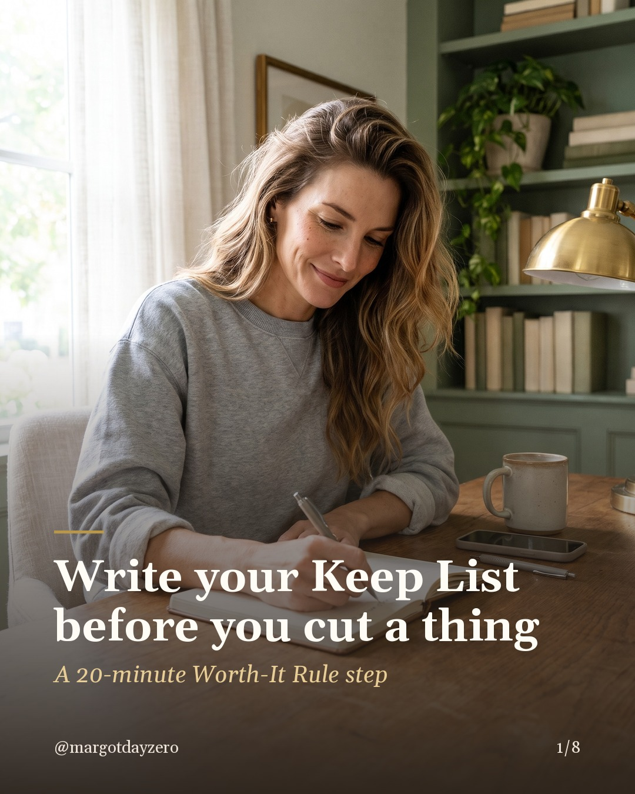
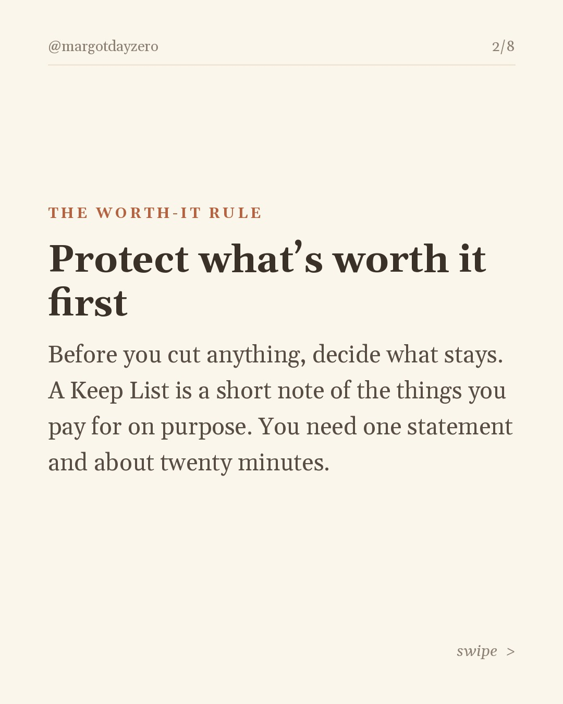
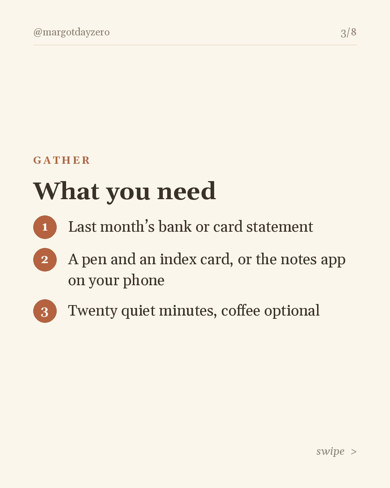
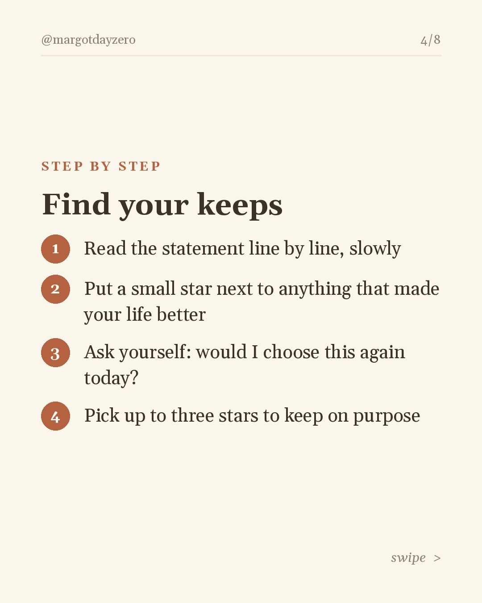
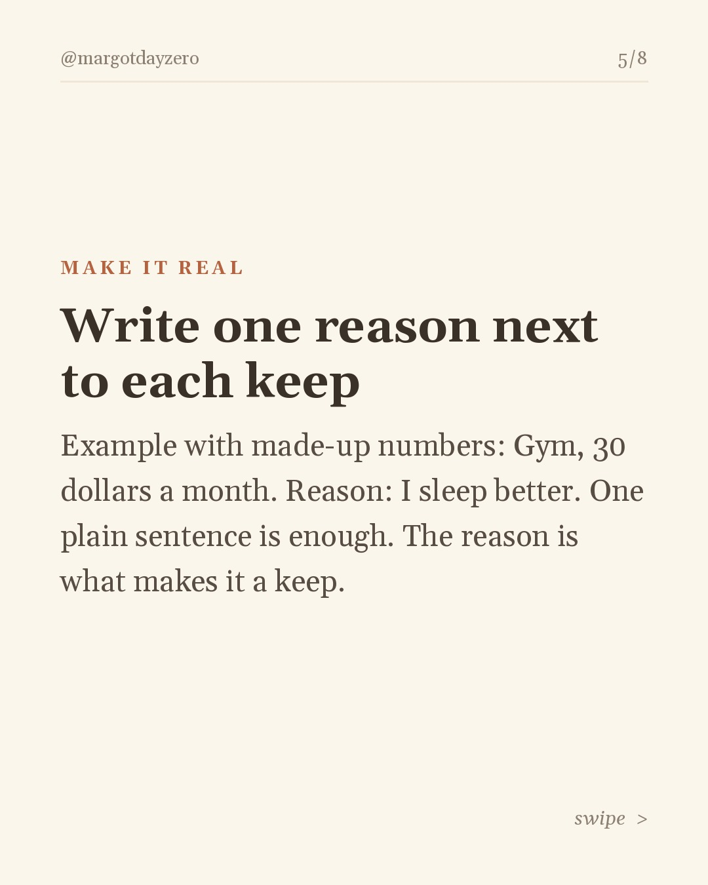
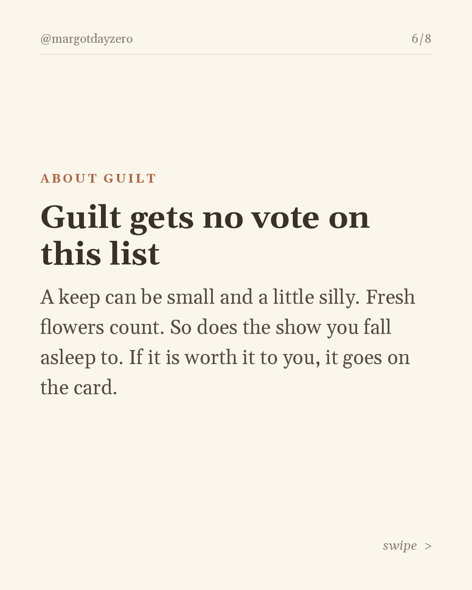
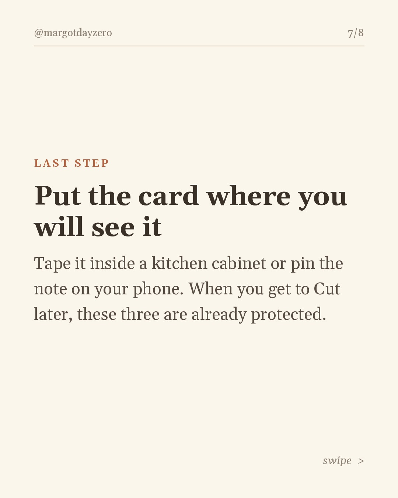
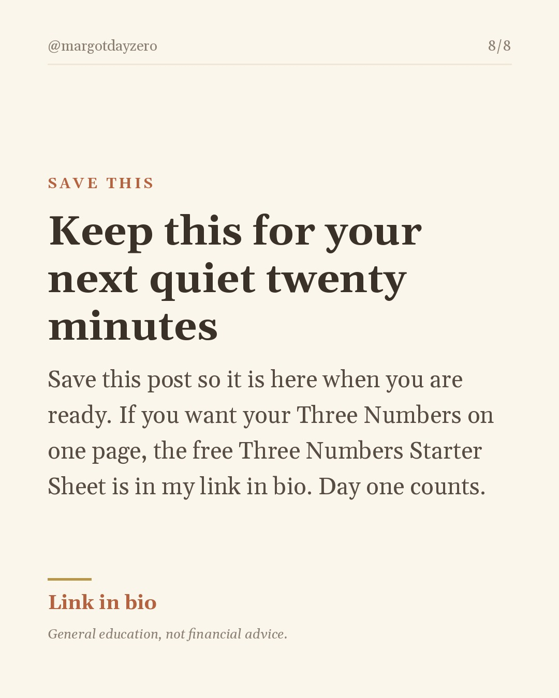

**Scheduled to post Tuesday, November 17 at 8 AM Eastern.**

To skip it, just **close this issue**. Do nothing and it posts automatically.

**Topic:** KEEP: writing a three-item Keep List from last month's statement, so you protect what's worth it before you cut anything










**Caption:**

```
Before you cut anything, write down what stays.
Grab last month's statement and an index card.
Star the things that made your life better, then pick up to three.
Write one plain reason next to each. That card is your Keep List, and it is allowed to include flowers.
Save this for a quiet twenty minutes this week.
The free Three Numbers Starter Sheet is in my link in bio if you want everything on one page.
Day one counts.

General education, not financial advice.

#lifeafterdivorce #startingover #budgetingbasics #moneyafterdivorce #womenandmoney
```
