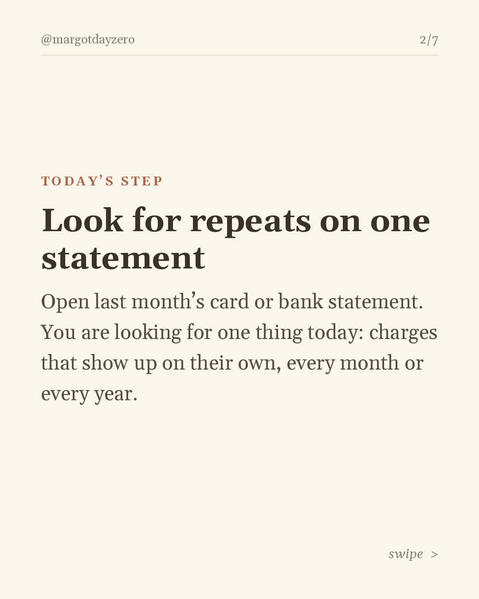
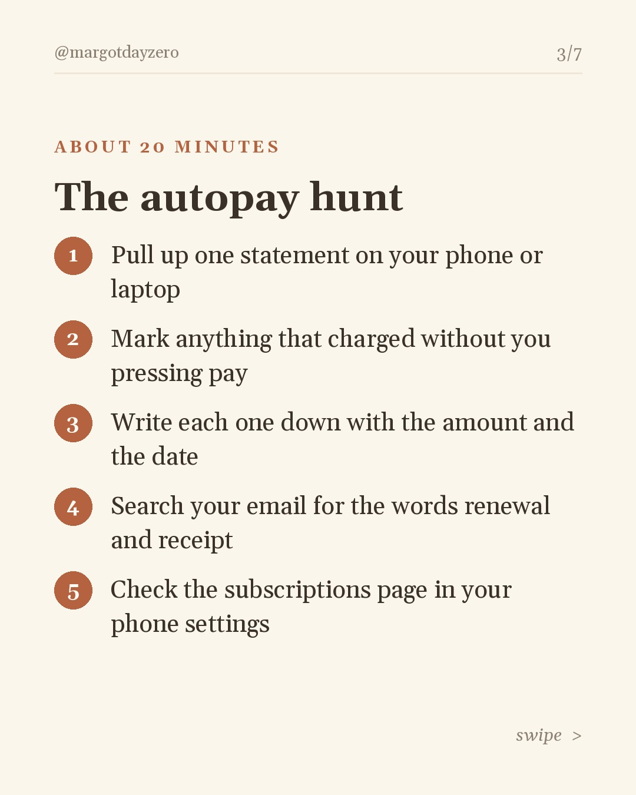
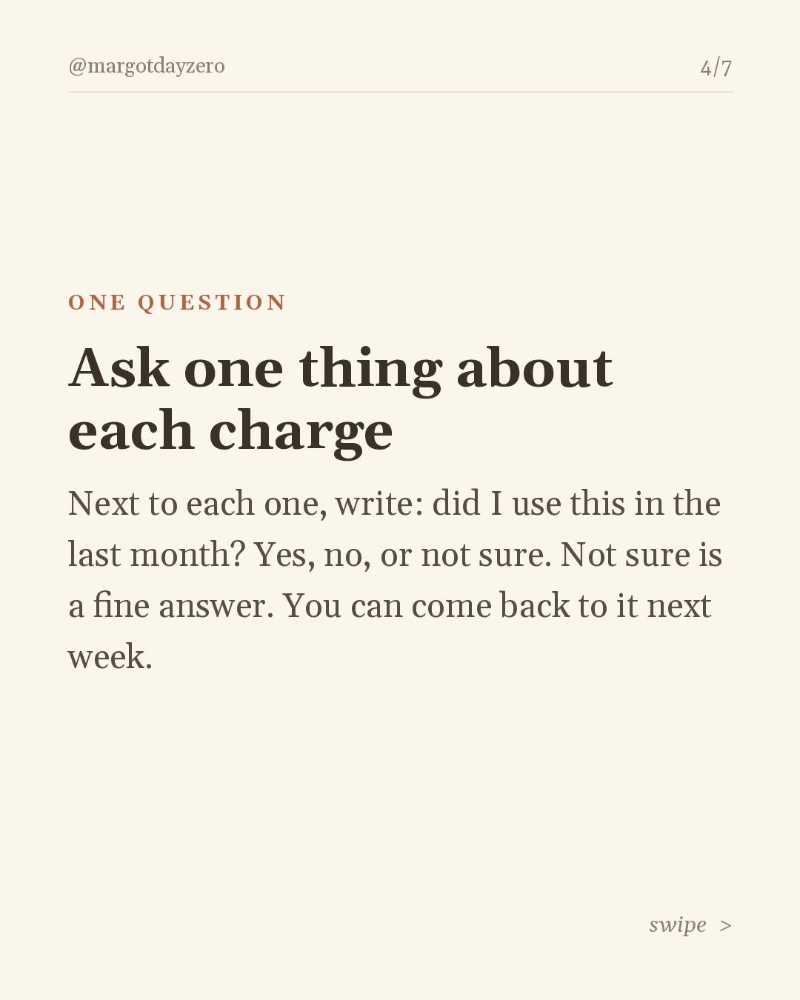
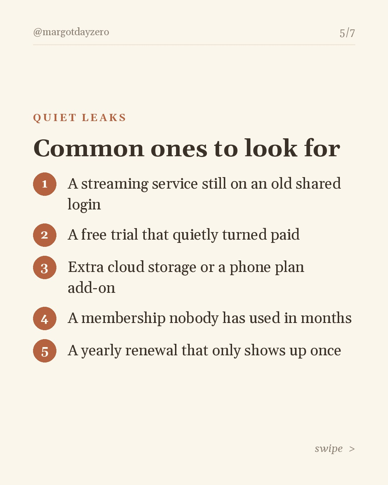
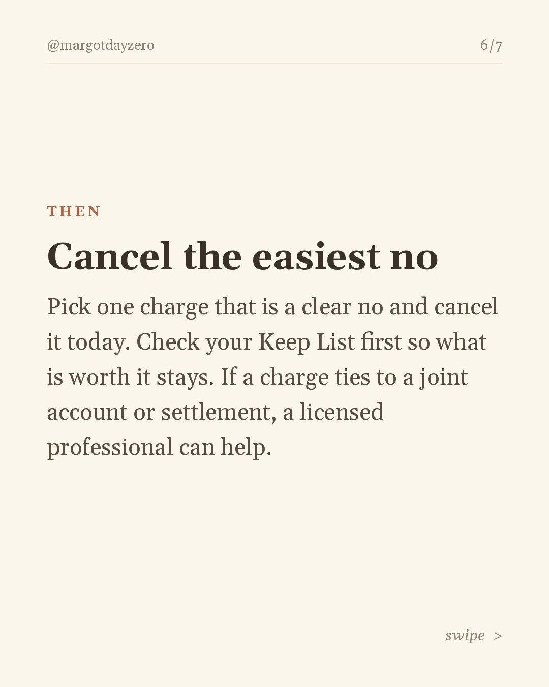
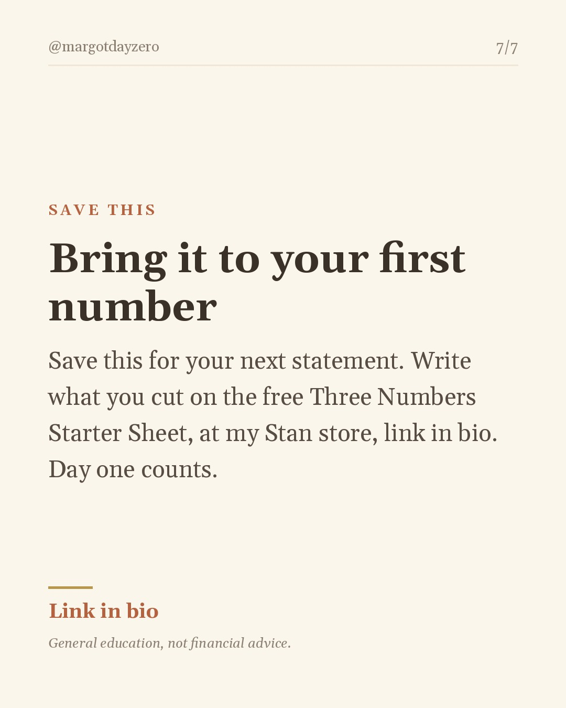

**Scheduled to post Wednesday, November 18 at 8 AM Eastern.**

To skip it, just **close this issue**. Do nothing and it posts automatically.

**Topic:** CUT: a calm 20-minute autopay hunt on one statement to find repeating charges and cancel the easiest no









**Caption:**

```
There may be a charge on your statement that renews without asking you.
Today, open one statement and look for anything that repeats.
Write each one down with the amount and the date.
Ask yourself, did I use this last month? Then cancel the easiest no.
Save this for the next time a statement lands.
The free Three Numbers Starter Sheet is waiting at my Stan store, link in bio.
Day one counts.

General education, not financial advice.

#lifeafterdivorce #subscriptionaudit #budgetingbasics #moneyafterdivorce #startingover
```
