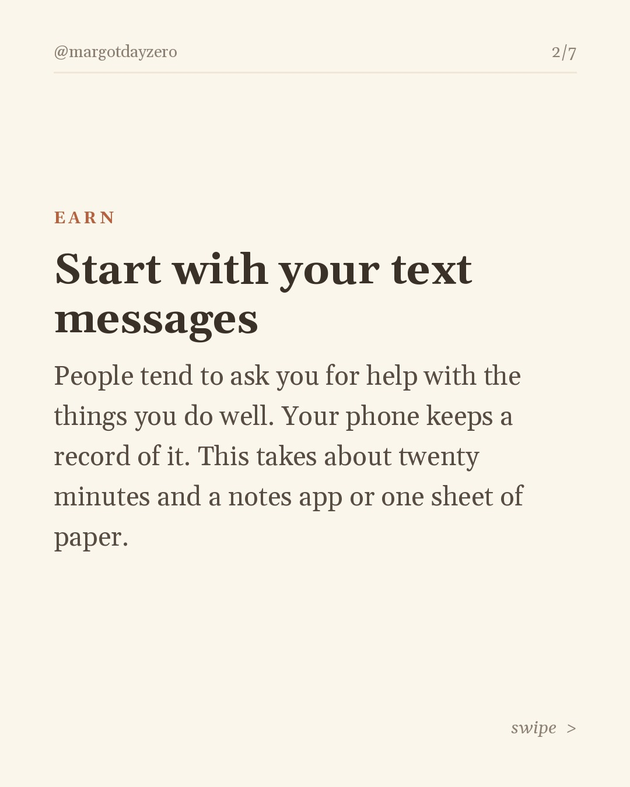
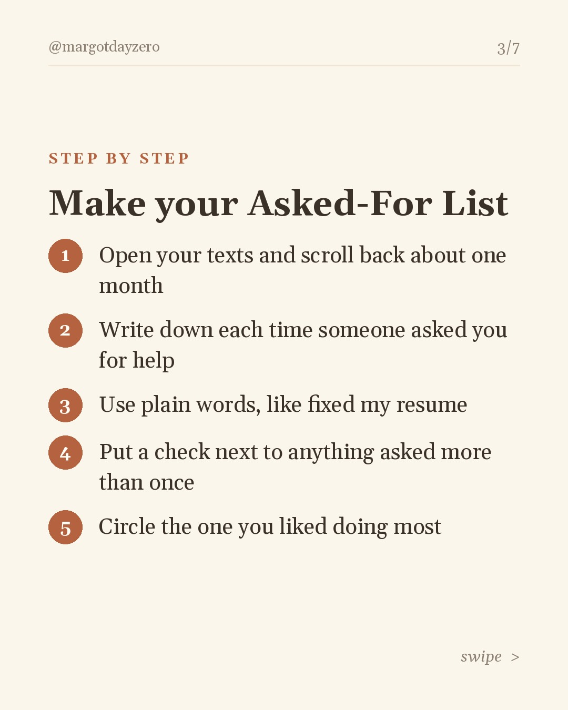
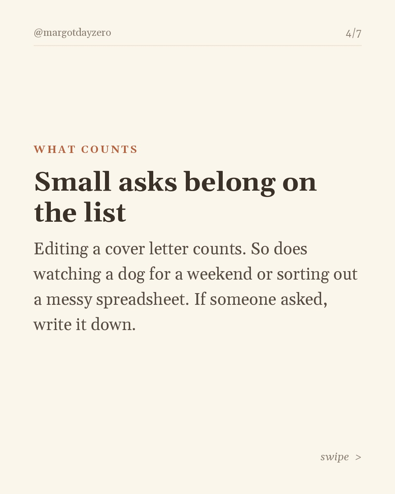
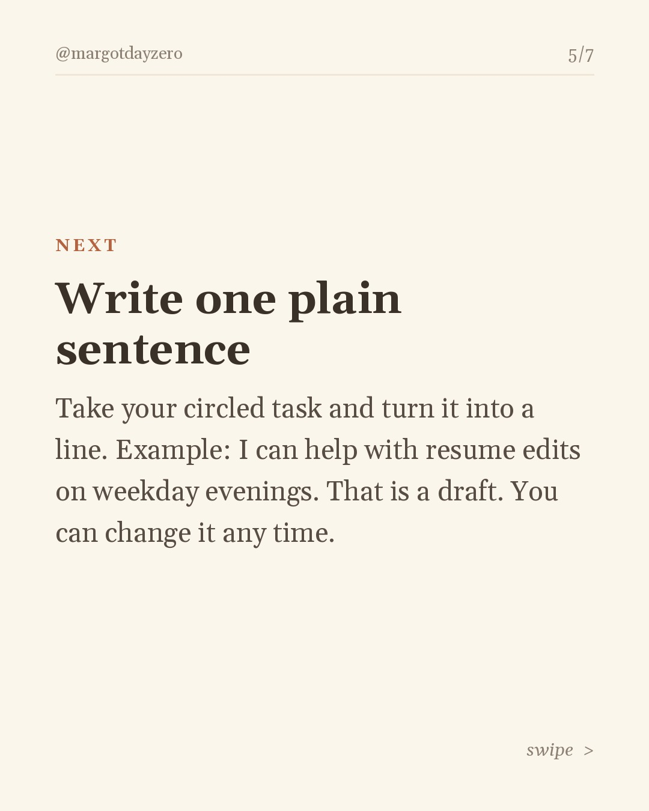
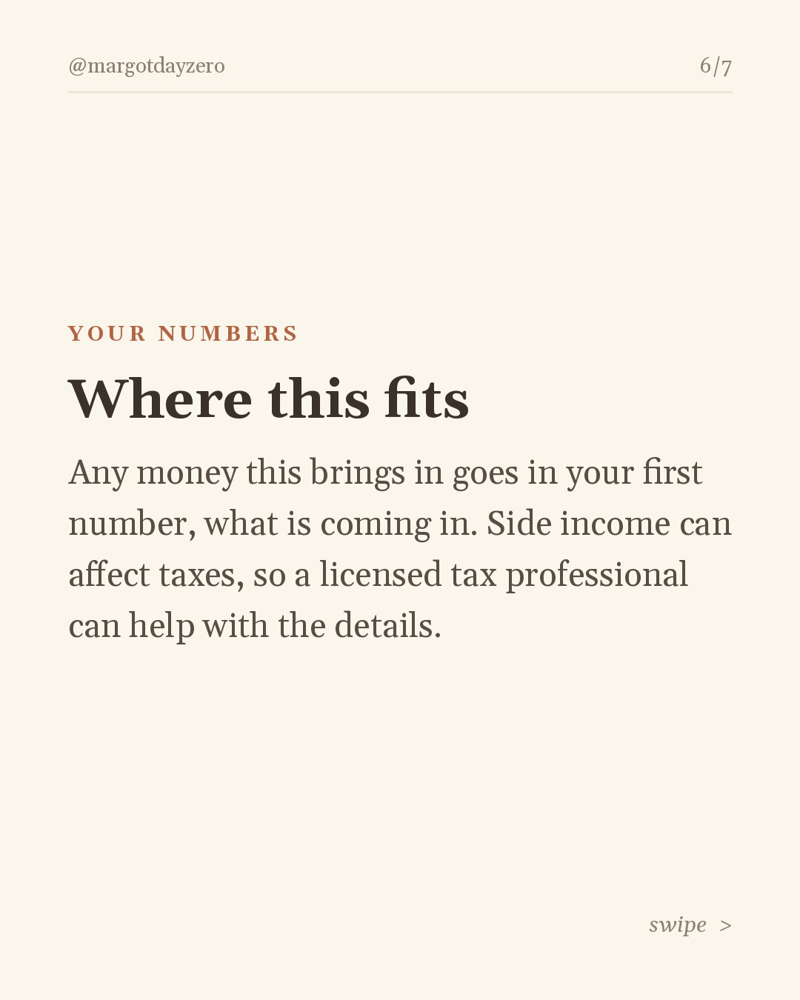
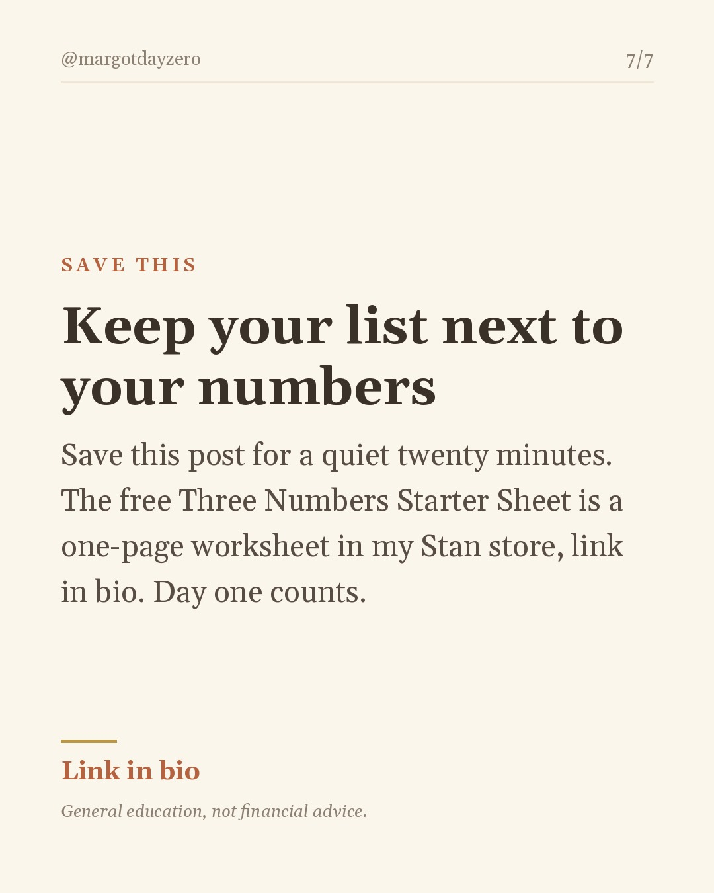

**Scheduled to post Thursday, November 19 at 8 AM Eastern.**

To skip it, just **close this issue**. Do nothing and it posts automatically.

**Topic:** EARN: a 20-minute Asked-For List made by scrolling one month of text messages to spot skills people already ask you for, then writing one plain sentence offer









**Caption:**

```
Your phone already knows what you are good at. 📱

Scroll back one month in your texts and write down every time someone asked you for help.
Circle the task you liked doing most.
Then write one plain sentence about it, like: I can help with resume edits on weekday evenings.
That sentence is a small start, and it is yours to change.

Save this for a quiet twenty minutes this week.

Want a place to write your Three Numbers next to it? The free Three Numbers Starter Sheet is a one-page worksheet, link in bio.

Day one counts.

General education, not financial advice.

#lifeafterdivorce #divorcedwomen #sideincomeideas #moneyafterdivorce #startingover
```
