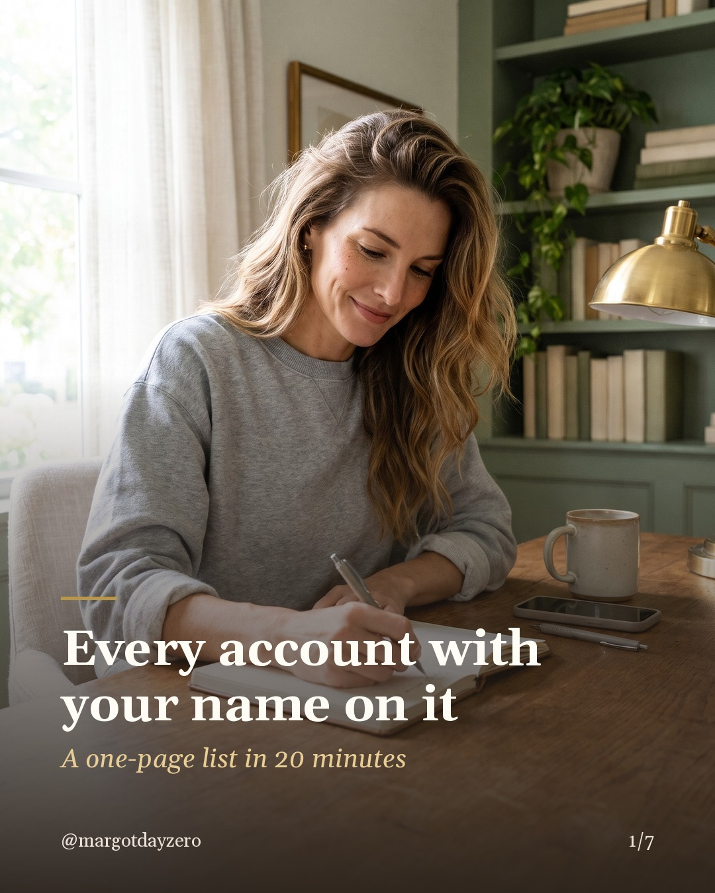
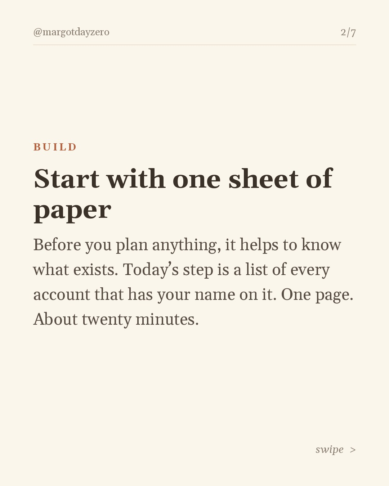
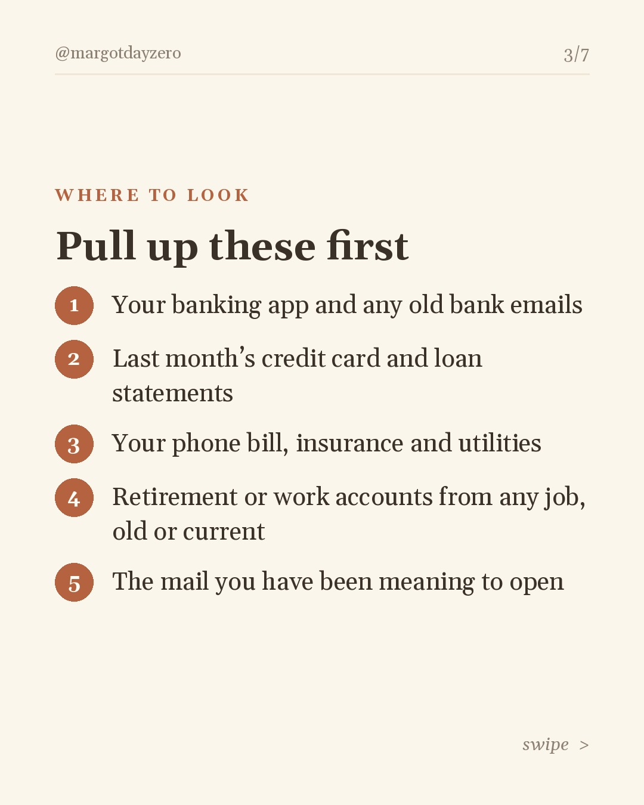
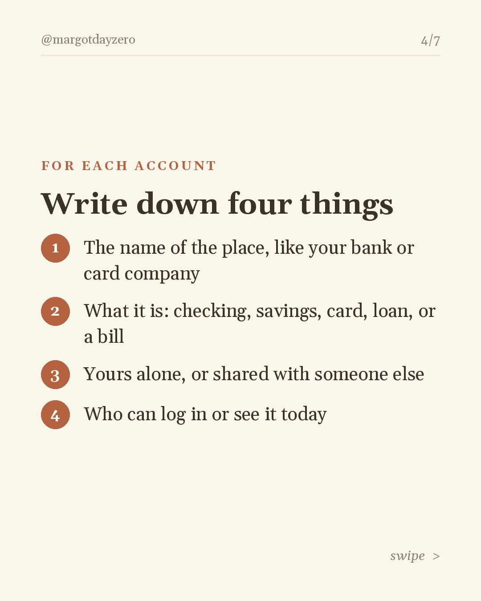
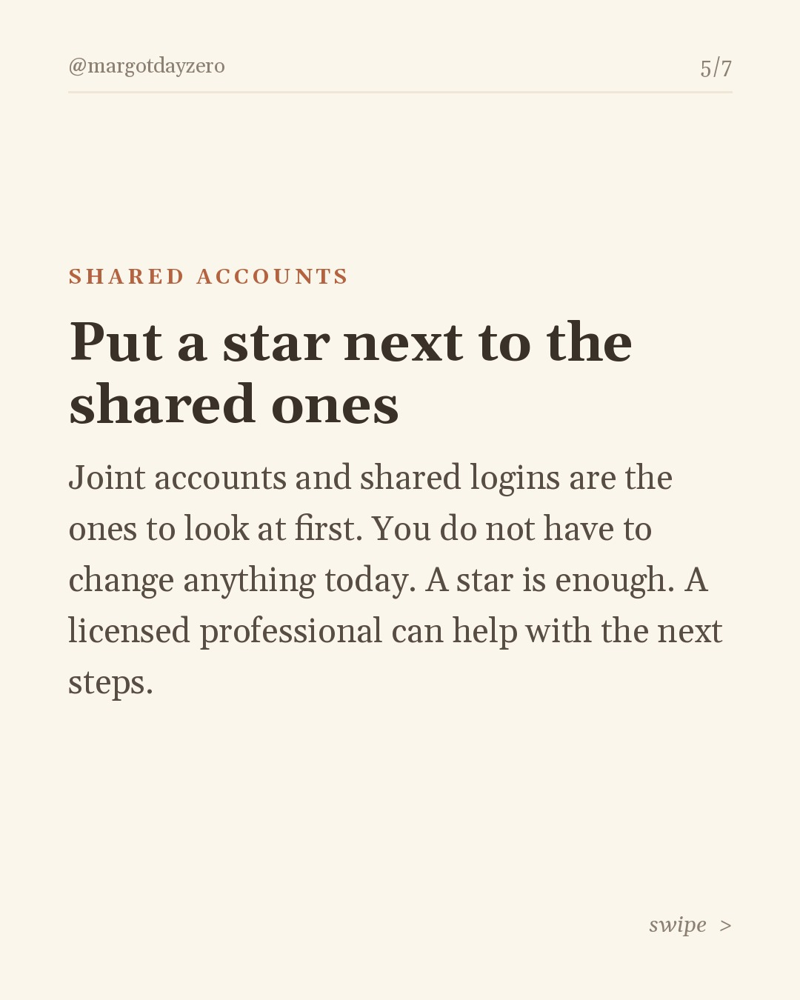
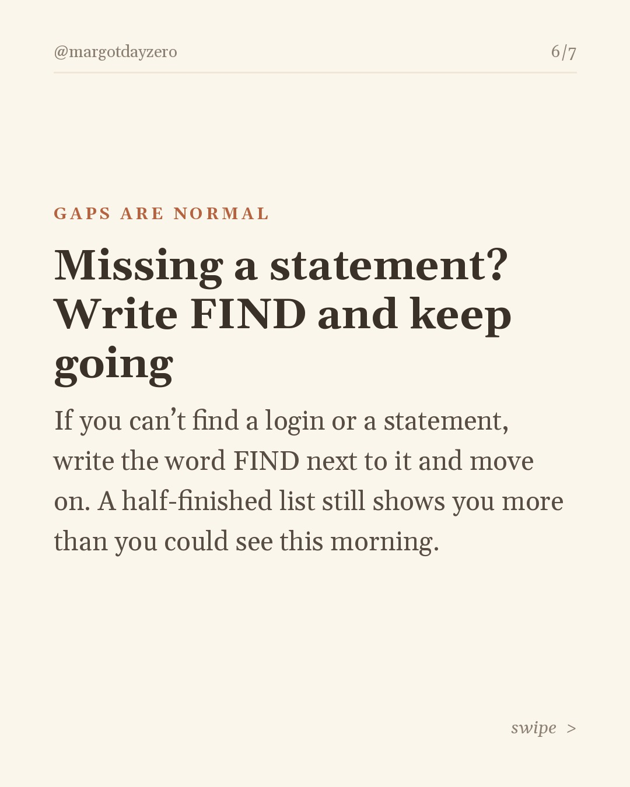
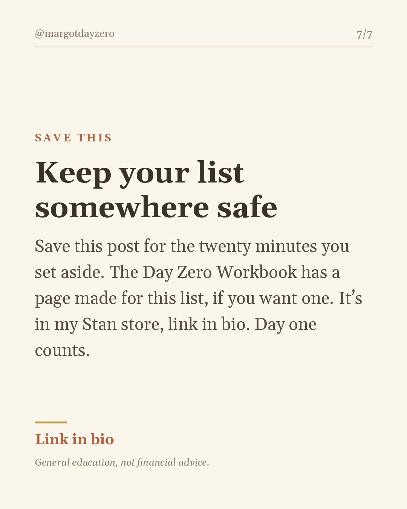

**Scheduled to post Friday, November 20 at 8 AM Eastern.**

To skip it, just **close this issue**. Do nothing and it posts automatically.

**Topic:** BUILD: a 20-minute one-page list of every account that has your name on it, with shared accounts marked for later









**Caption:**

```
Do you know every account that has your name on it?

Today's BUILD step is one sheet of paper and about twenty minutes.
Open your banking app, last month's statements and that pile of mail.
For each account, write the name, what it is, whether it's shared, and who can log in.
Put a star next to the shared ones. You don't have to fix anything today.

Save this for when you have a quiet twenty minutes.
If you'd like a page made for this list, The Day Zero Workbook has one. It's in my Stan store, link in bio.

If someone else controls your accounts and you feel unsafe, the National Domestic Violence Hotline is 1-800-799-7233.

Day one counts.

General education, not financial advice.

#lifeafterdivorce #divorcedwomen #moneybasics #financialfirststeps #startingover
```
