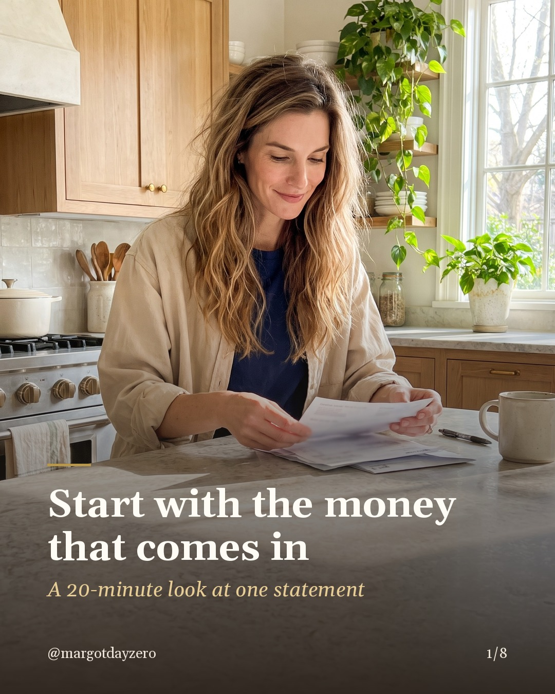
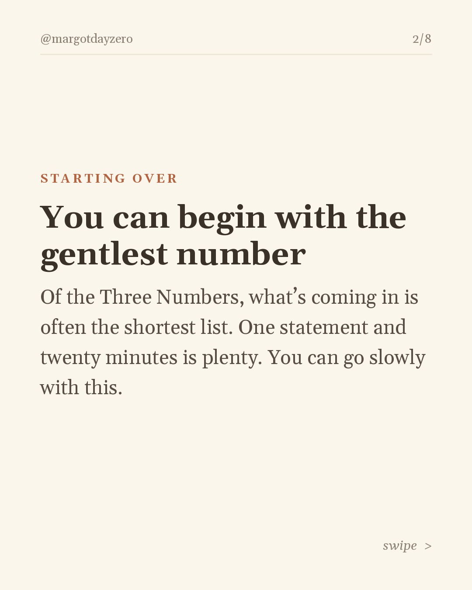
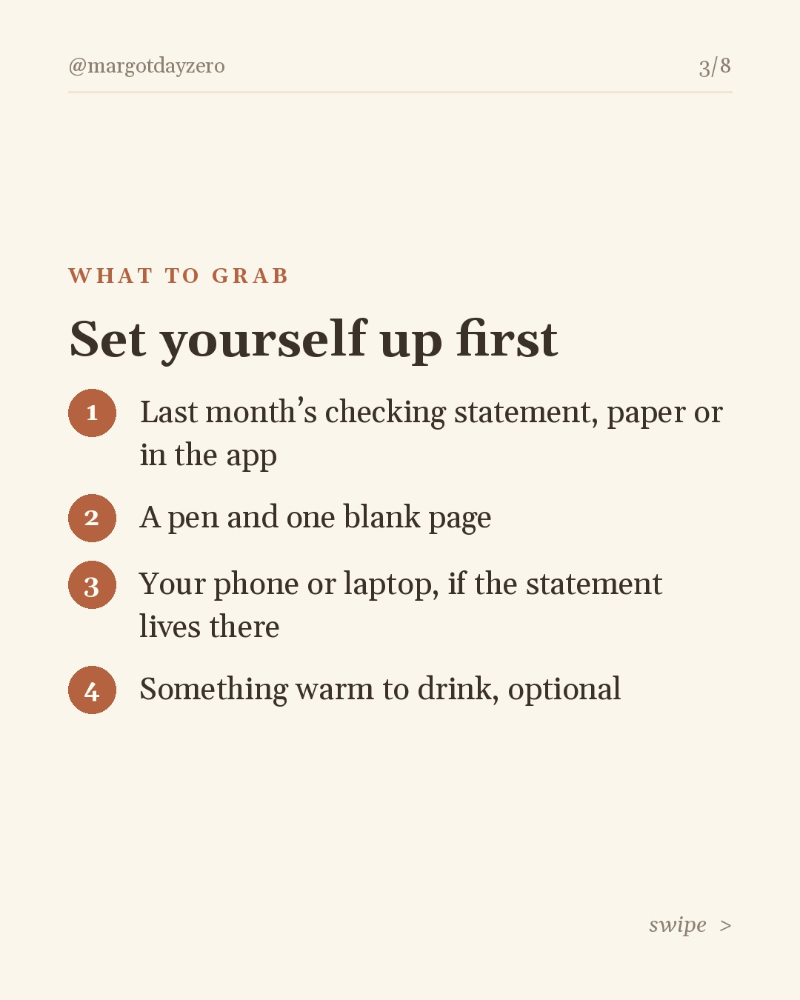
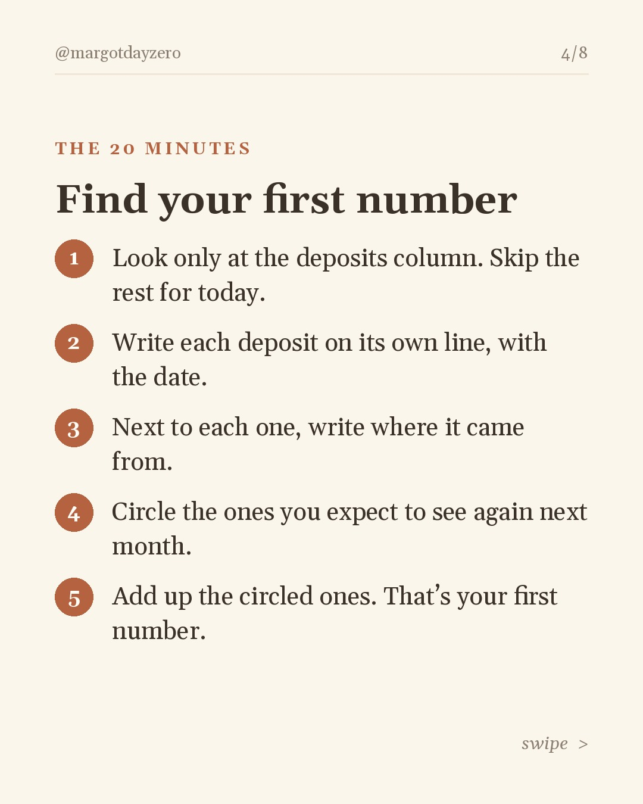
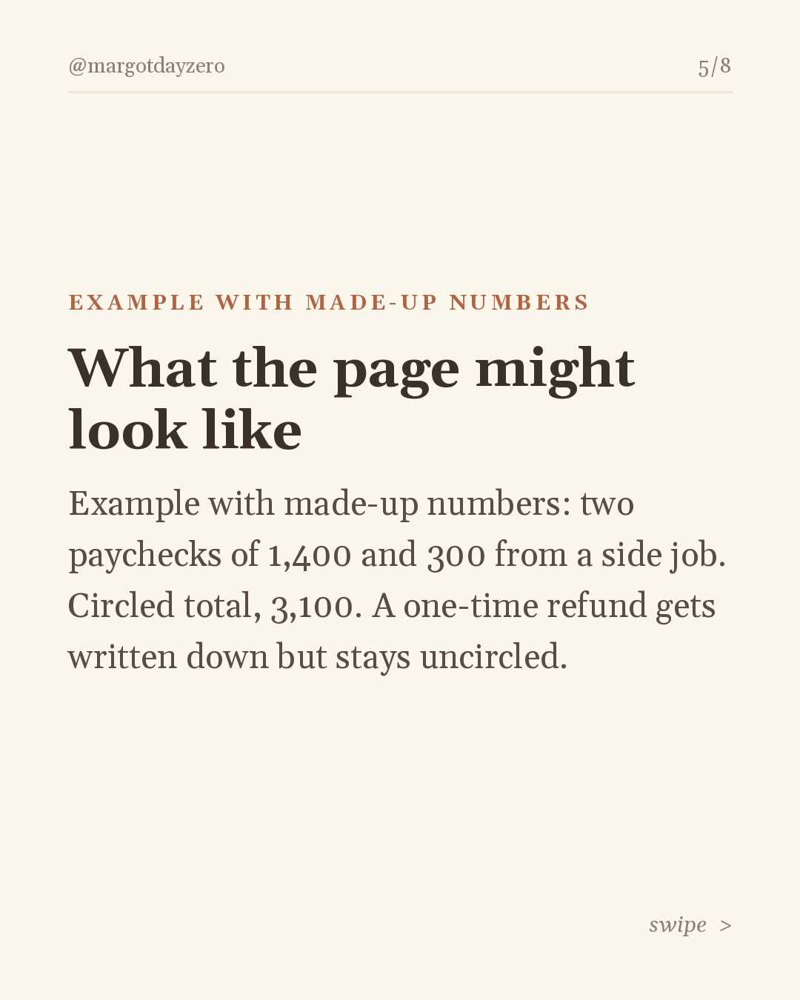
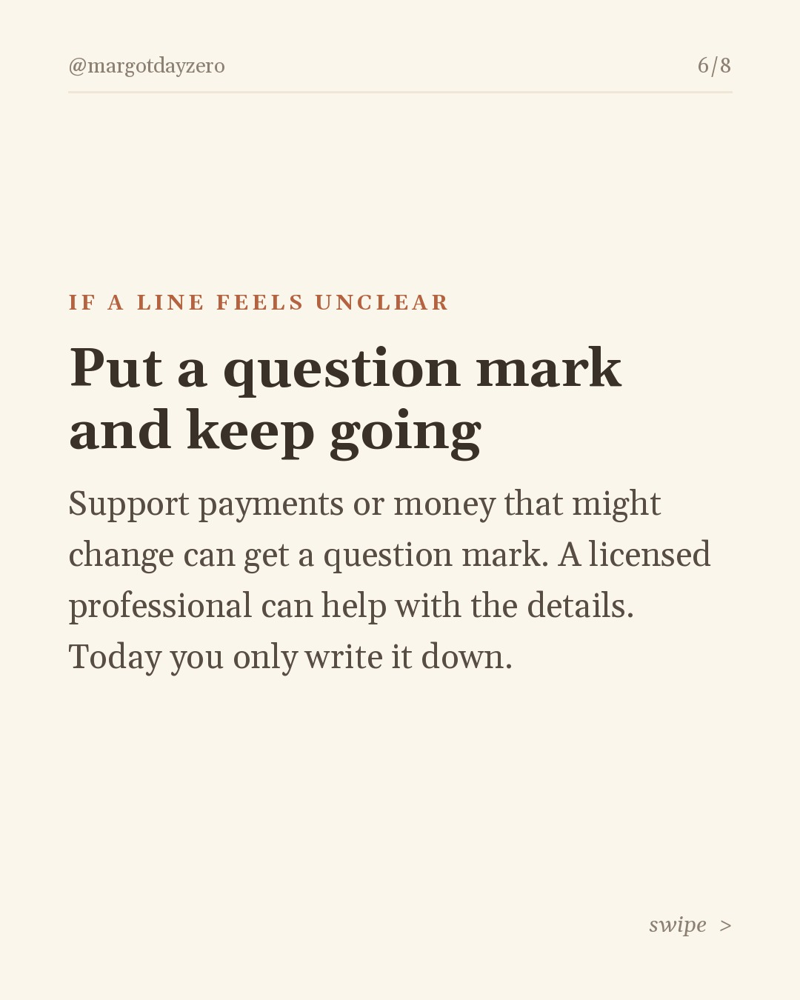
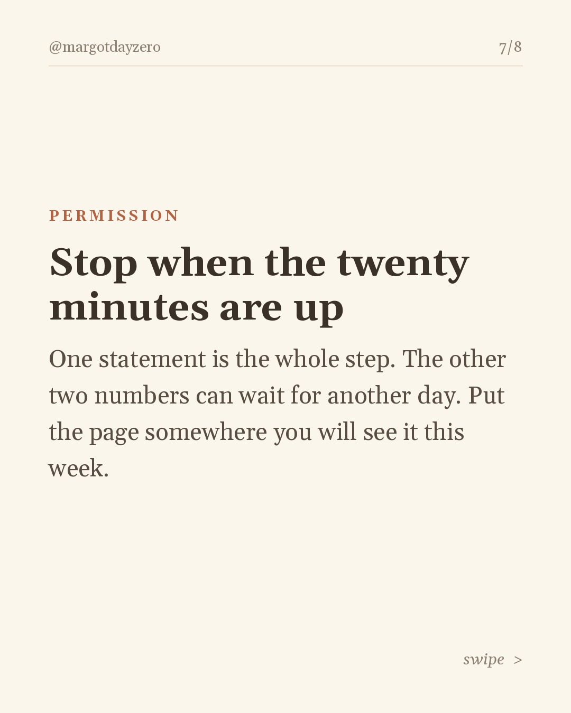
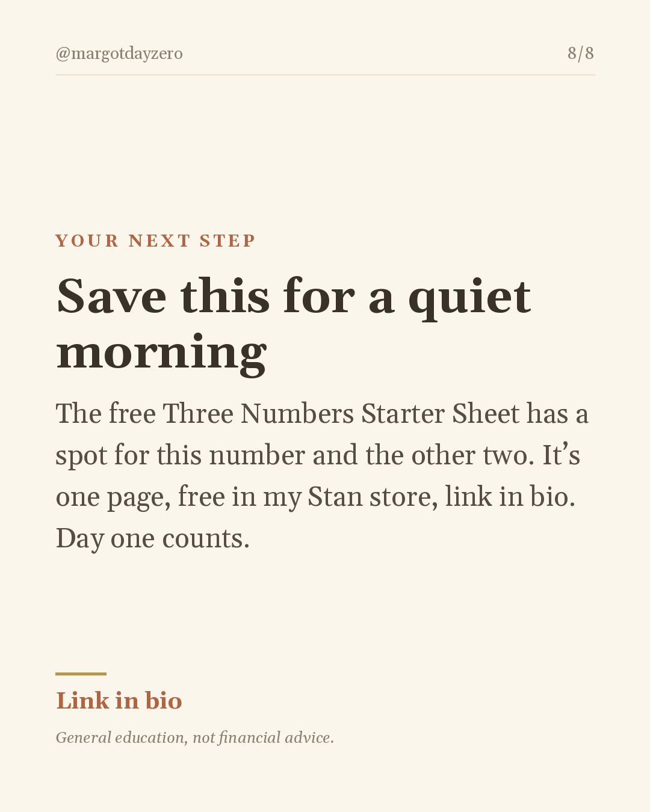

**Scheduled to post Saturday, November 21 at 8 AM Eastern.**

To skip it, just **close this issue**. Do nothing and it posts automatically.

**Topic:** STARTING OVER: finding your first number, what's coming in, by circling the repeating deposits on last month's checking statement in about 20 minutes










**Caption:**

```
If starting over feels like too much, start with the money that comes in.
Grab last month's checking statement and look only at the deposits.
Write each one down, circle the ones you expect again, and add those up.
That's your first number. Unsure lines get a question mark, and that's fine.
Save this for a quiet morning when you have twenty minutes ☕
The free Three Numbers Starter Sheet gives this number a home. Link in bio.
Day one counts.

General education, not financial advice.

#lifeafterdivorce #startingover #moneybasics #budgetingforbeginners #divorcedwomen
```
