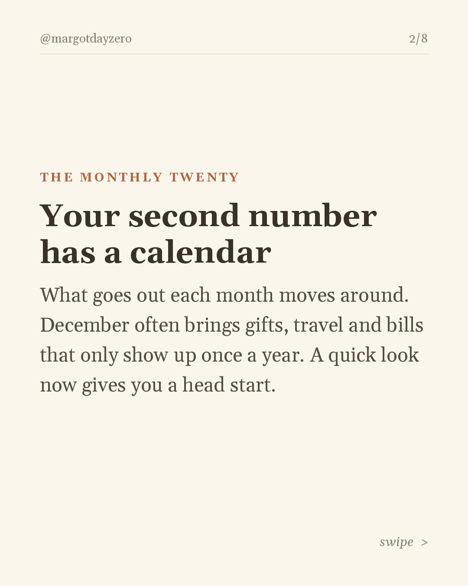
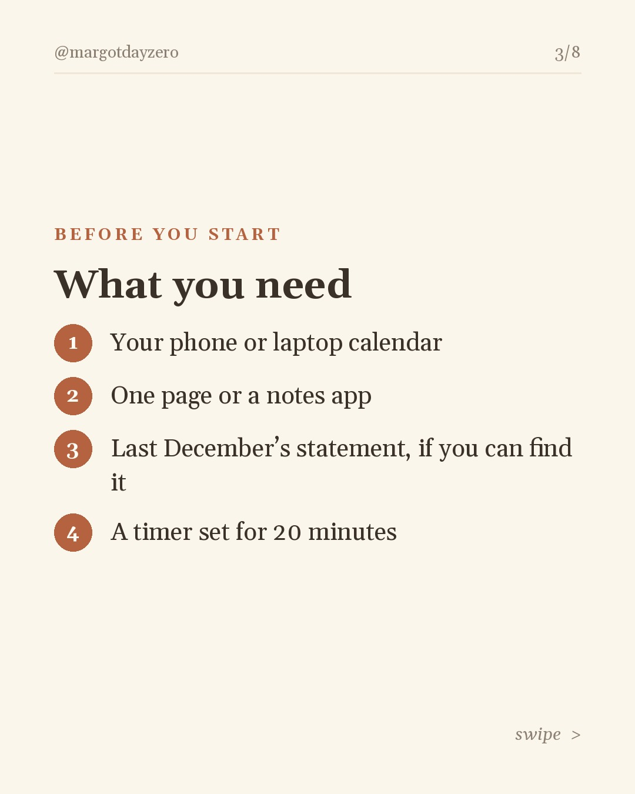
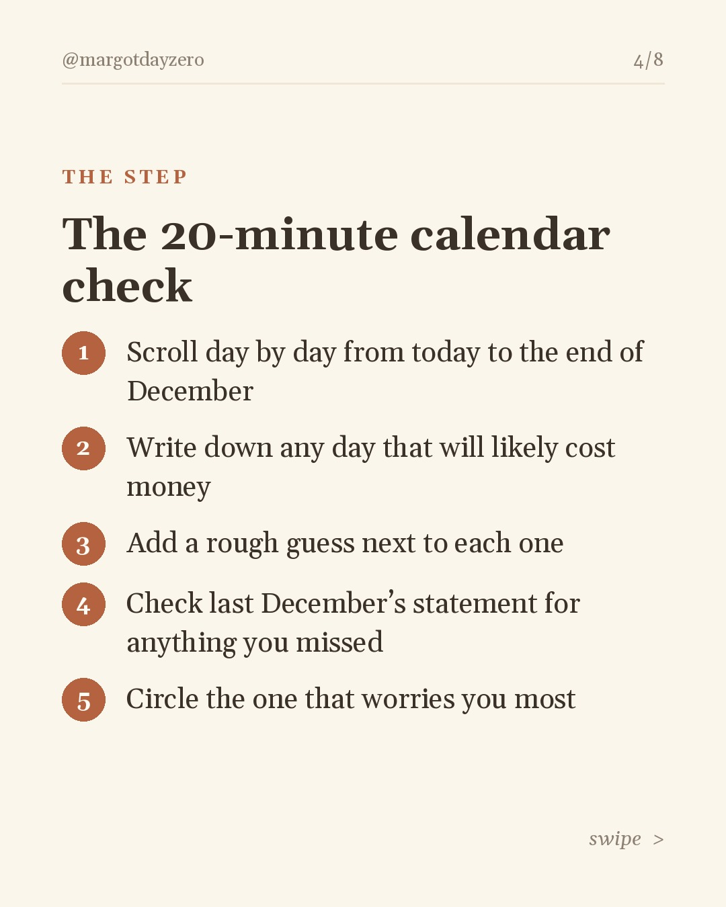
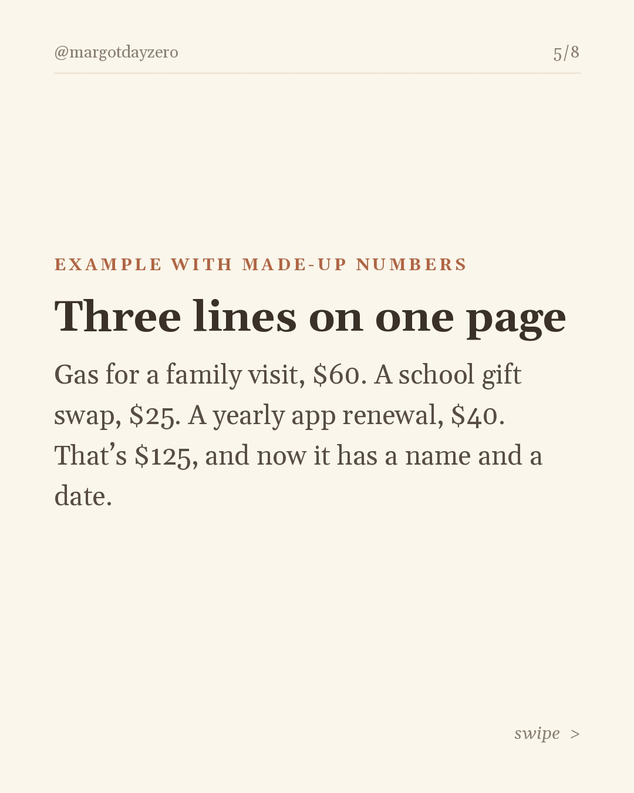
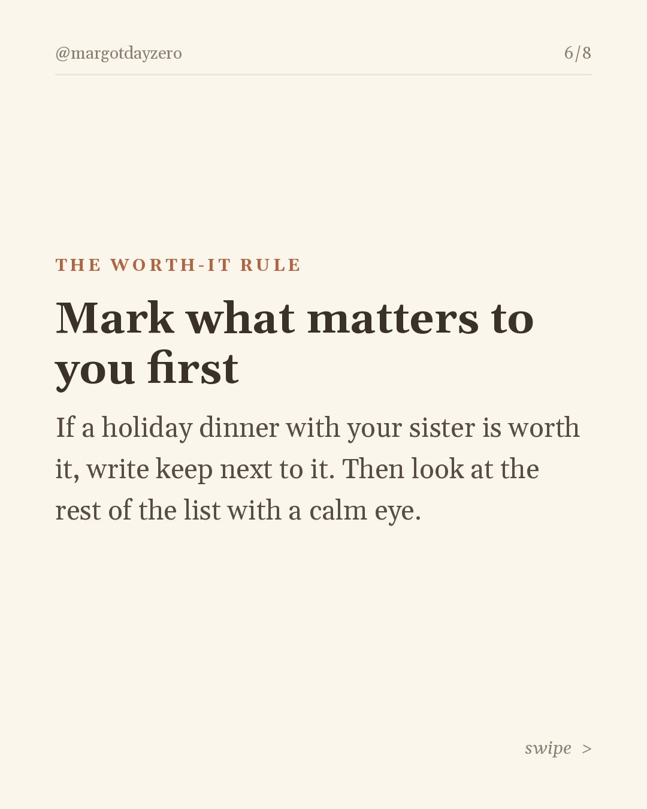
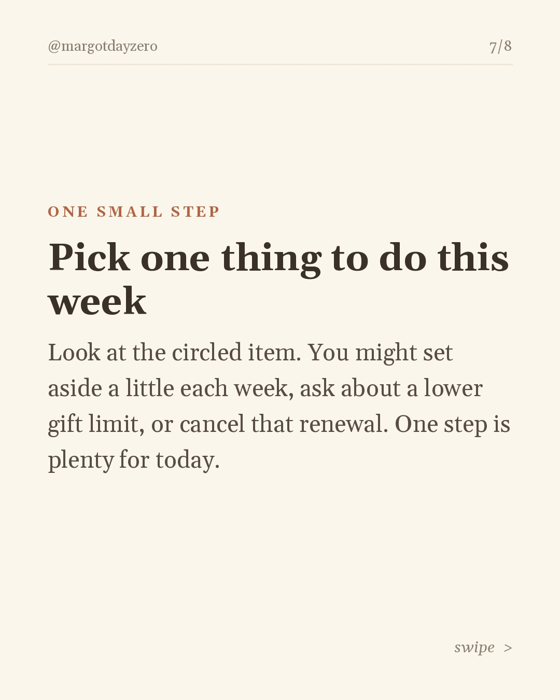
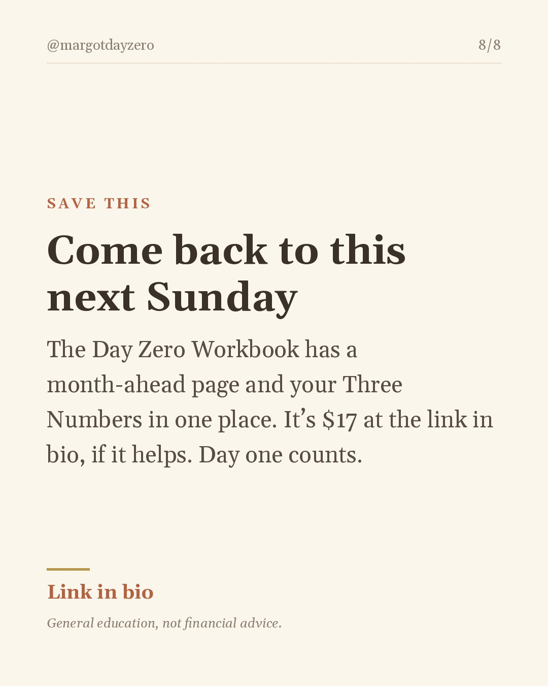

**Scheduled to post Sunday, November 22 at 8 AM Eastern.**

To skip it, just **close this issue**. Do nothing and it posts automatically.

**Topic:** The Monthly Twenty: a 20-minute calendar check from today to the end of December, listing every day likely to cost money so your second number has no surprises










**Caption:**

```
December has a way of sneaking up on a budget.

This week's Monthly Twenty is a calendar check. Open your phone calendar and scroll from today to the end of December.
Write down every day that might cost money, with a rough guess next to each one.
Then circle the one that worries you most and pick one small step for it.

Save this so you can do it tonight or next Sunday.
If you'd like a page made for this, The Day Zero Workbook is $17 at the link in bio.

Day one counts.

General education, not financial advice.

#lifeafterdivorce #budgetingforbeginners #holidaybudget #moneyreset #startingover
```
