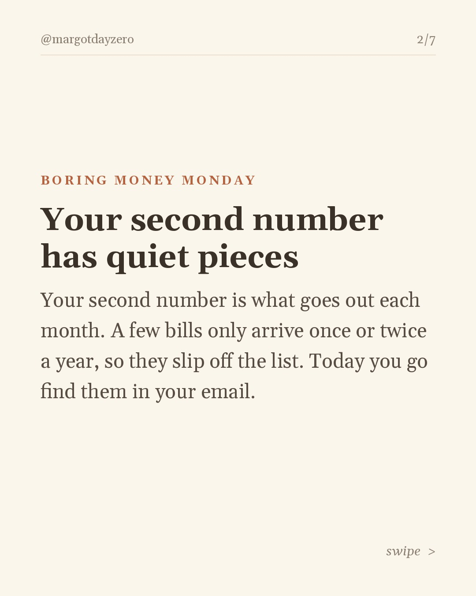
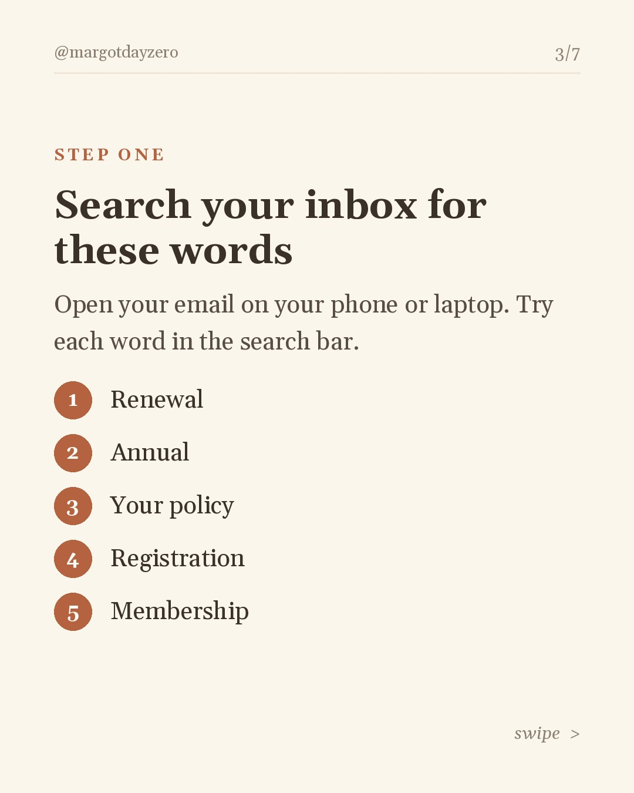
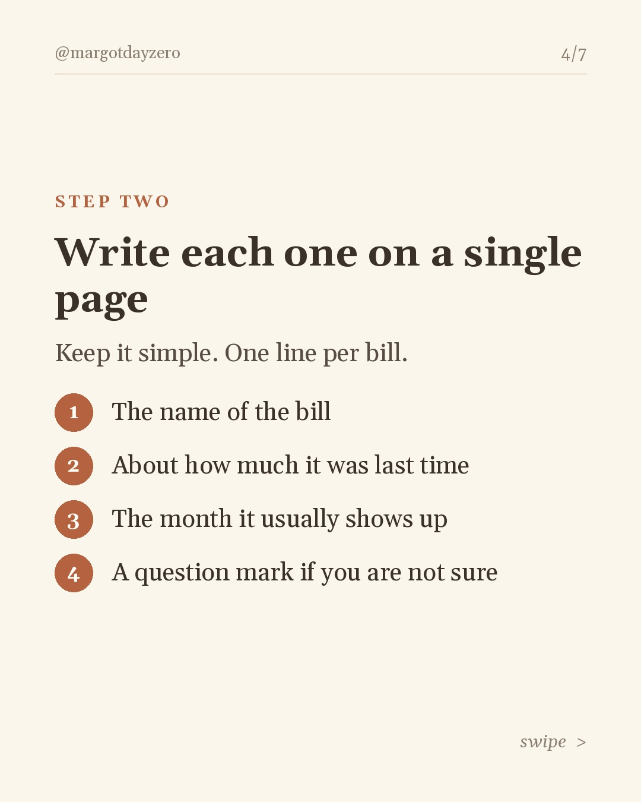
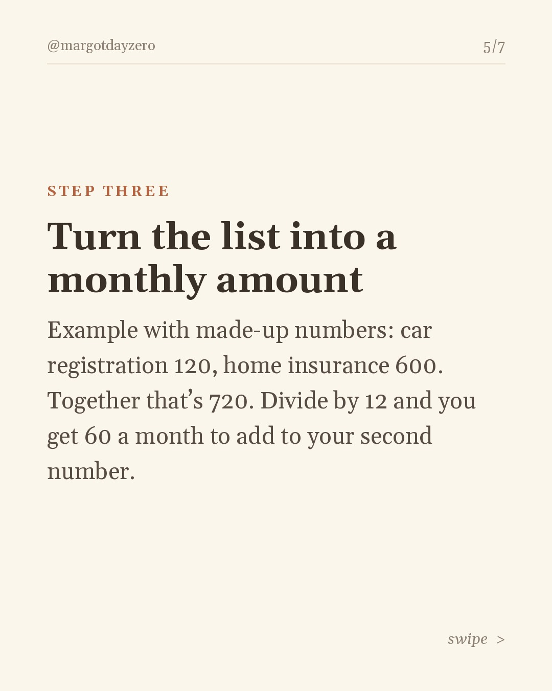
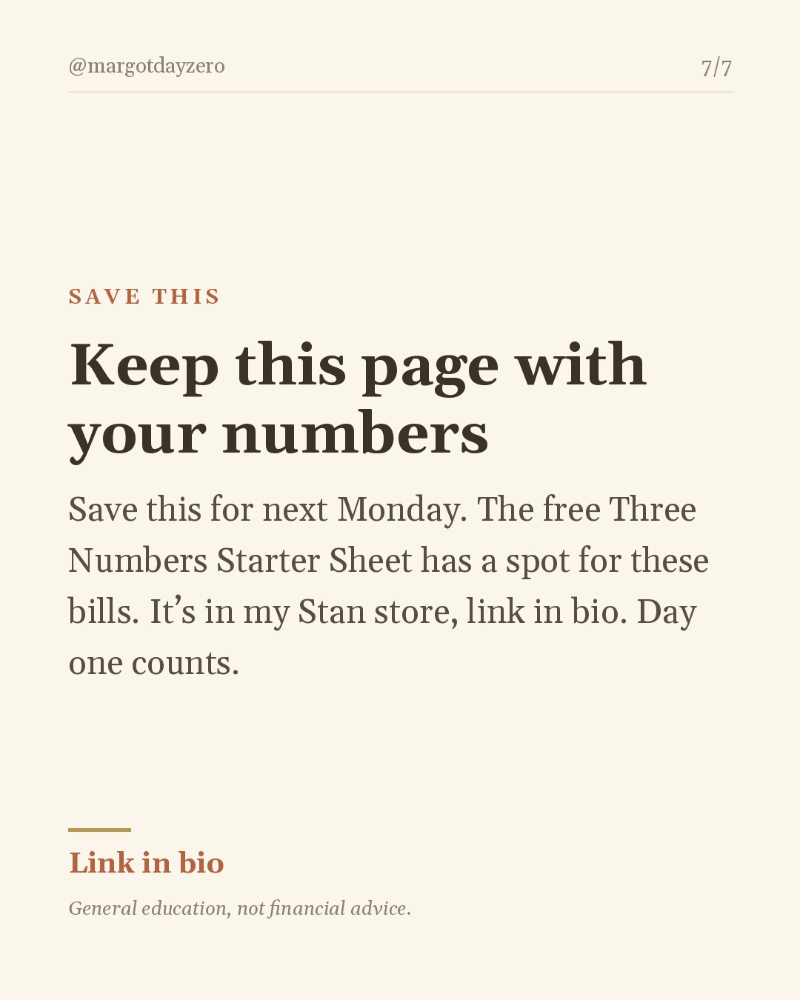

**Scheduled to post Monday, November 23 at 8 AM Eastern.**

To skip it, just **close this issue**. Do nothing and it posts automatically.

**Topic:** Finding once-a-year bills with a 20-minute email search and turning them into a monthly amount for your second number









**Caption:**

```
Some bills only show up once a year, and they always seem to pick an awkward month.
Today, search your email for words like renewal, annual and registration.
Write each bill on one page with the amount and the month it arrives.
Add them up, divide by 12, and add that to your second number.
Save this so you can do it with your coffee next Monday.
The free Three Numbers Starter Sheet is in my Stan store, link in bio.
Day one counts.

General education, not financial advice.

#boringmoneymonday #moneyafterdivorce #startingover #budgetingbasics #threenumbers
```
