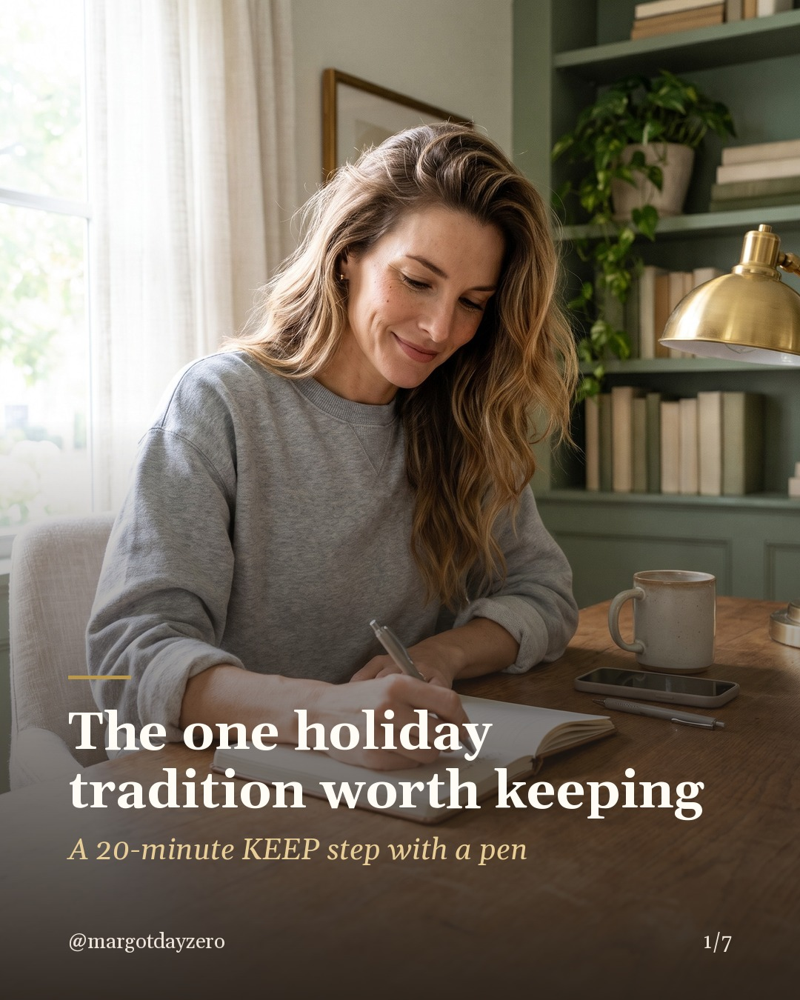
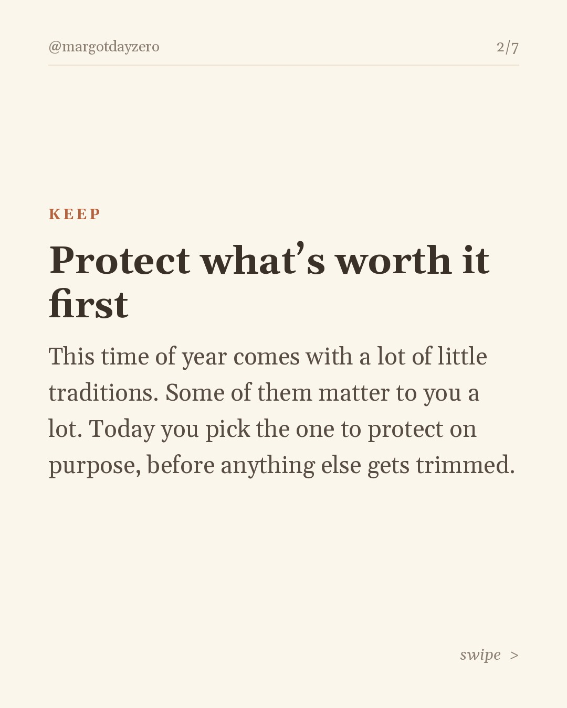
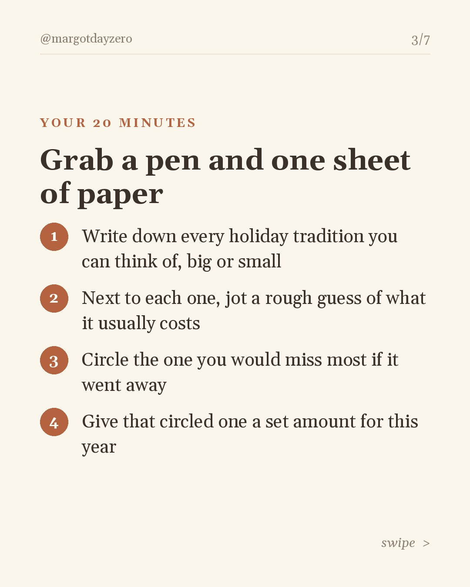
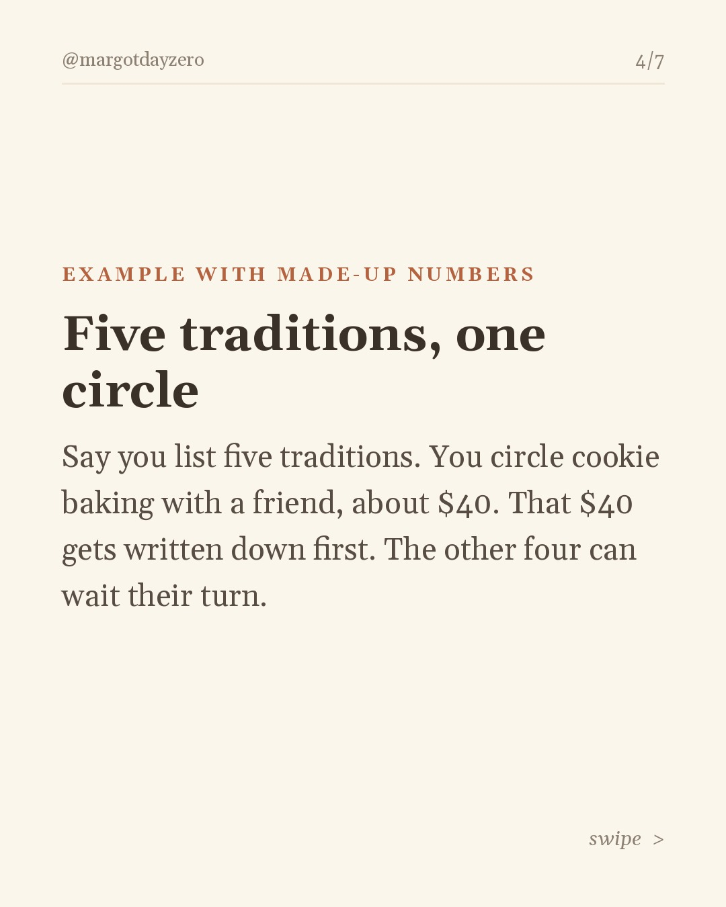
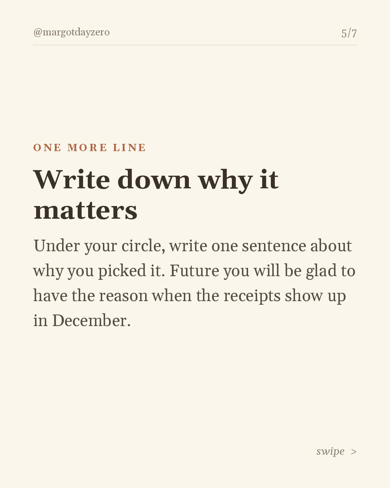
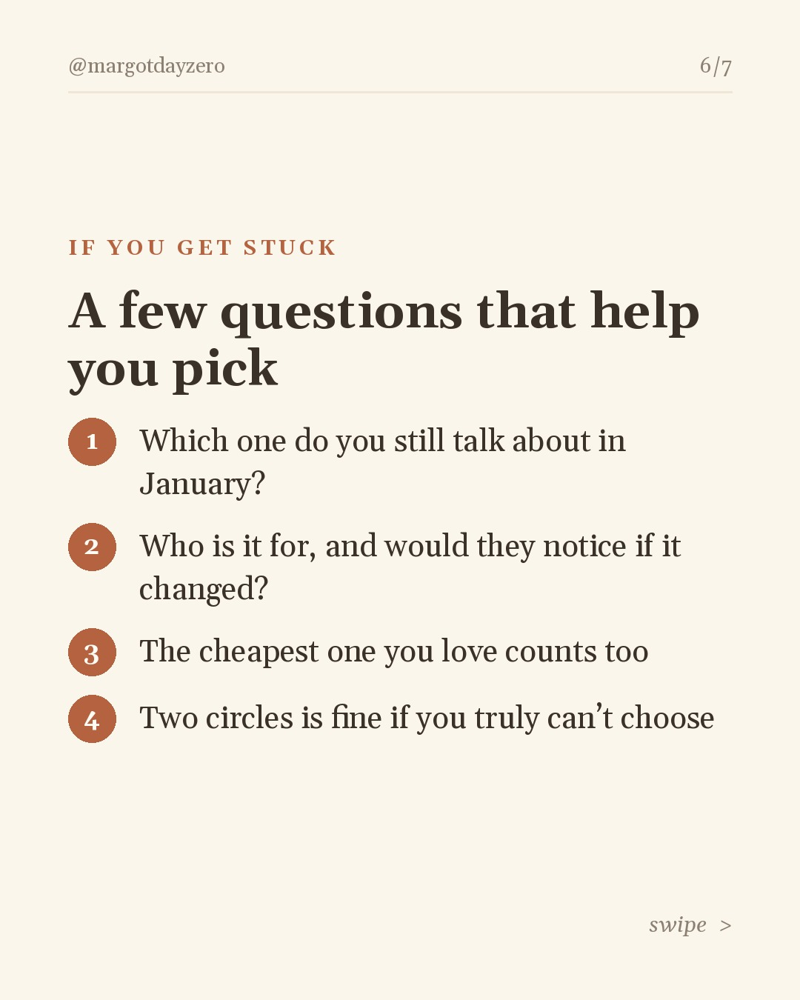
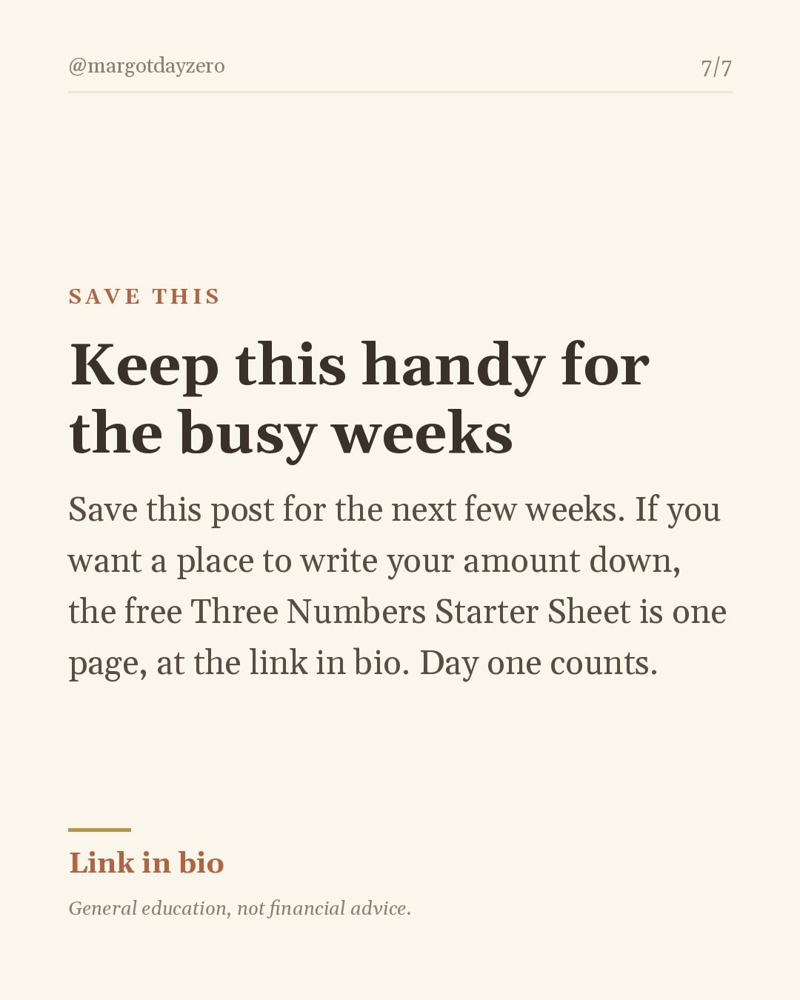

**Scheduled to post Tuesday, November 24 at 8 AM Eastern.**

To skip it, just **close this issue**. Do nothing and it posts automatically.

**Topic:** KEEP: picking the one holiday tradition worth protecting this year and giving it a set amount first, in about 20 minutes with a pen and paper









**Caption:**

```
Which holiday tradition would you miss most?

Take one sheet of paper and list every tradition you can think of, with a rough cost next to each.
Circle the one that matters most to you and give it a set amount first.
That's the Worth-It Rule. You protect what's worth it before you trim anything else.

Save this for the next few weeks, they move fast.
The free Three Numbers Starter Sheet gives you one page to write it all down. Link in bio.

Day one counts.

General education, not financial advice.

#lifeafterdivorce #startingover #holidaybudget #moneyafterdivorce #worthitrule
```
