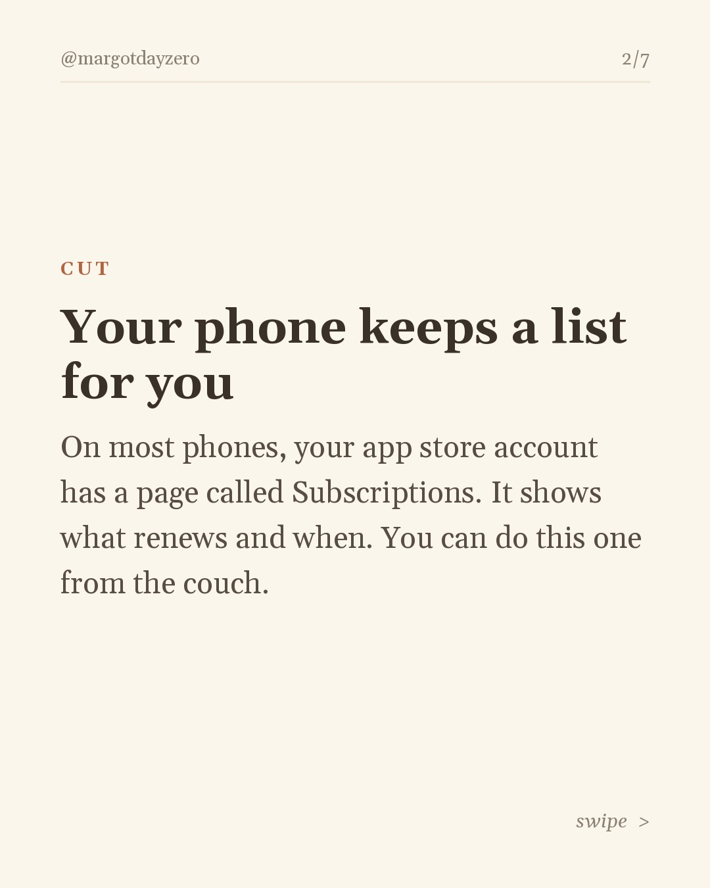
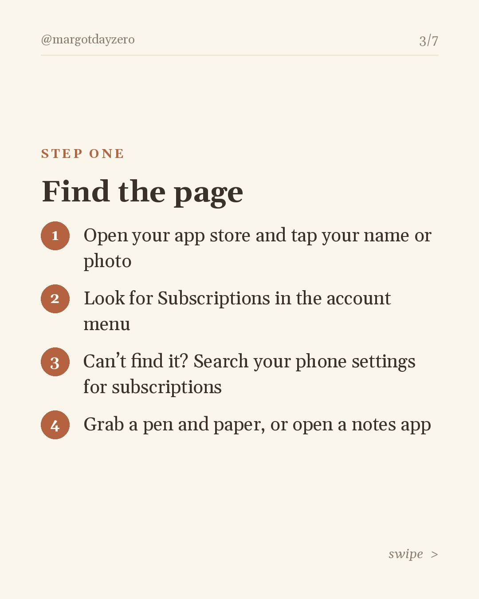
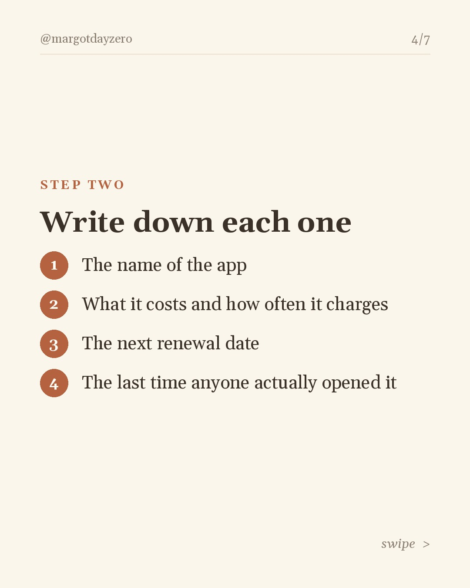
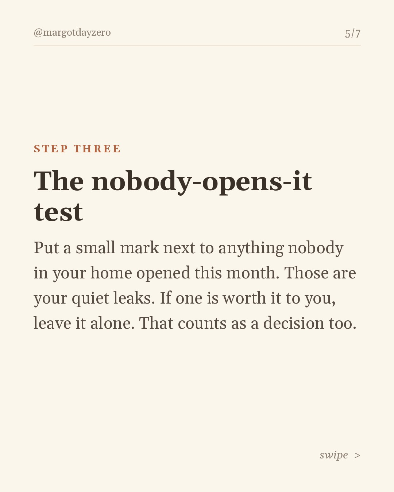
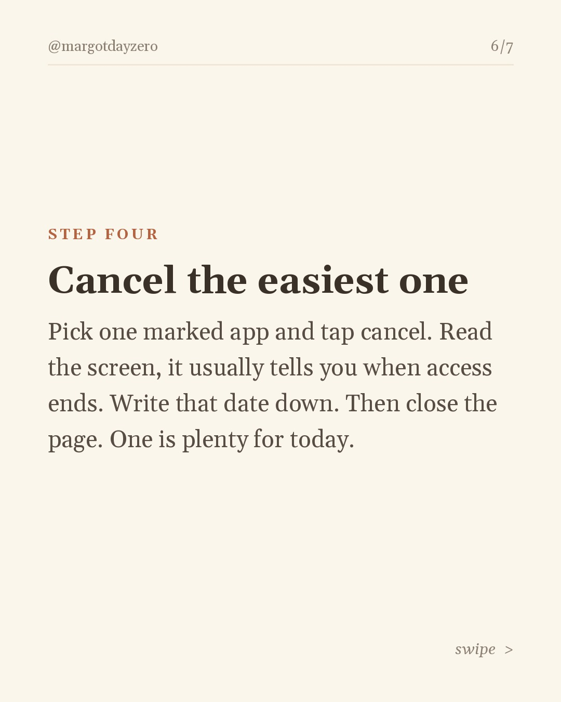
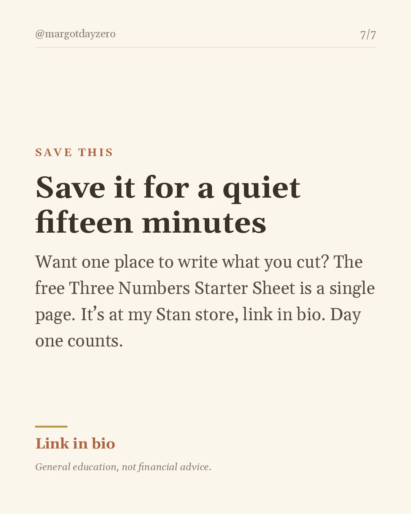

**Scheduled to post Wednesday, November 25 at 8 AM Eastern.**

To skip it, just **close this issue**. Do nothing and it posts automatically.

**Topic:** CUT: a 15-minute look at the Subscriptions page in your phone's app store account, marking apps nobody opens and canceling the easiest one









**Caption:**

```
Your phone already keeps a list of what you pay for every month.
It's the Subscriptions page in your app store account.
Write down each app, what it costs, and when it renews.
Mark the ones nobody opens. Cancel the easiest one and write down the date.
Save this for a quiet fifteen minutes this week.
The free Three Numbers Starter Sheet is a good home for what you find, link in bio.
Day one counts.

General education, not financial advice.

#divorcerecovery #startingover #budgetingbasics #subscriptions #moneyafterdivorce
```
