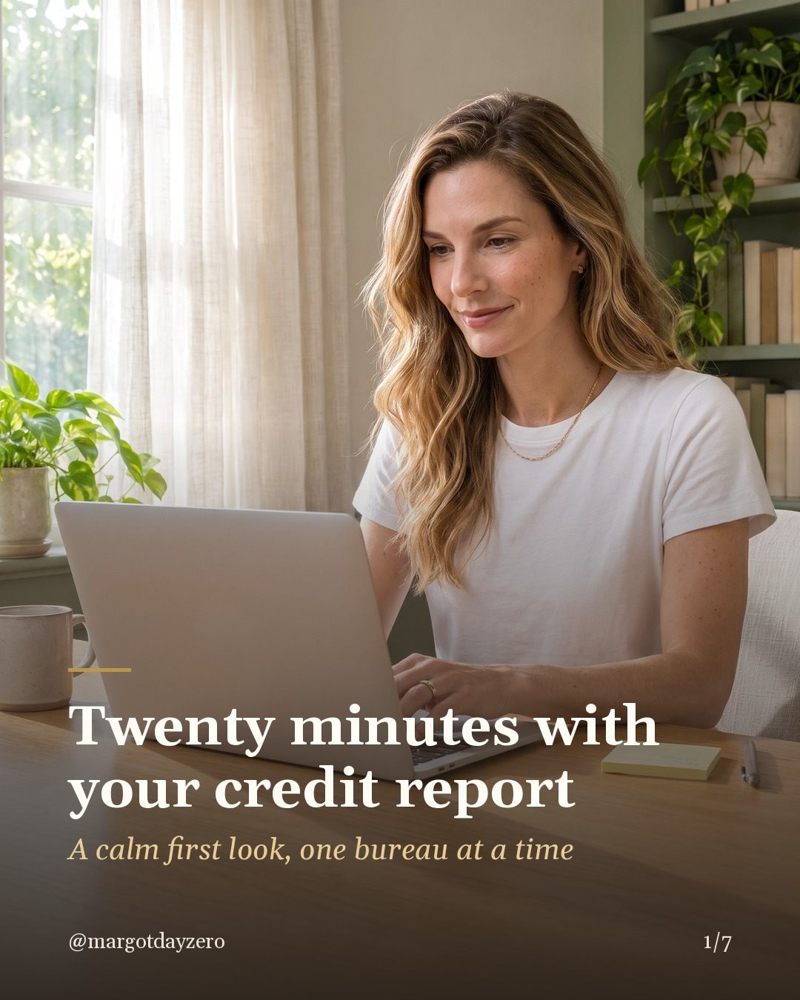
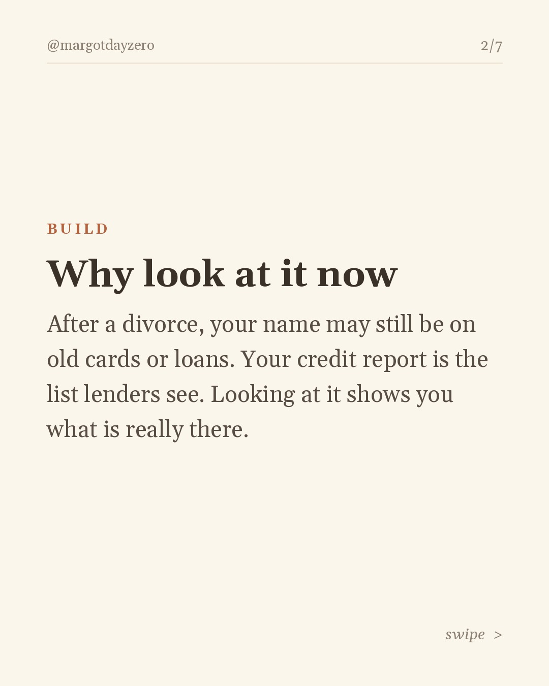
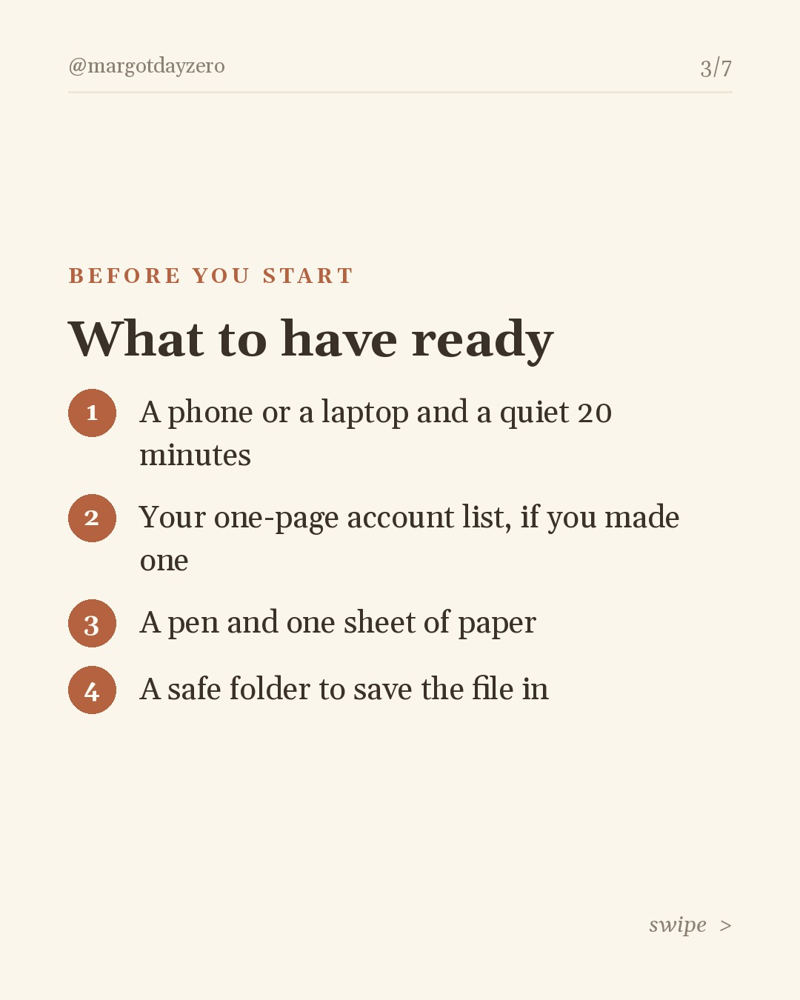
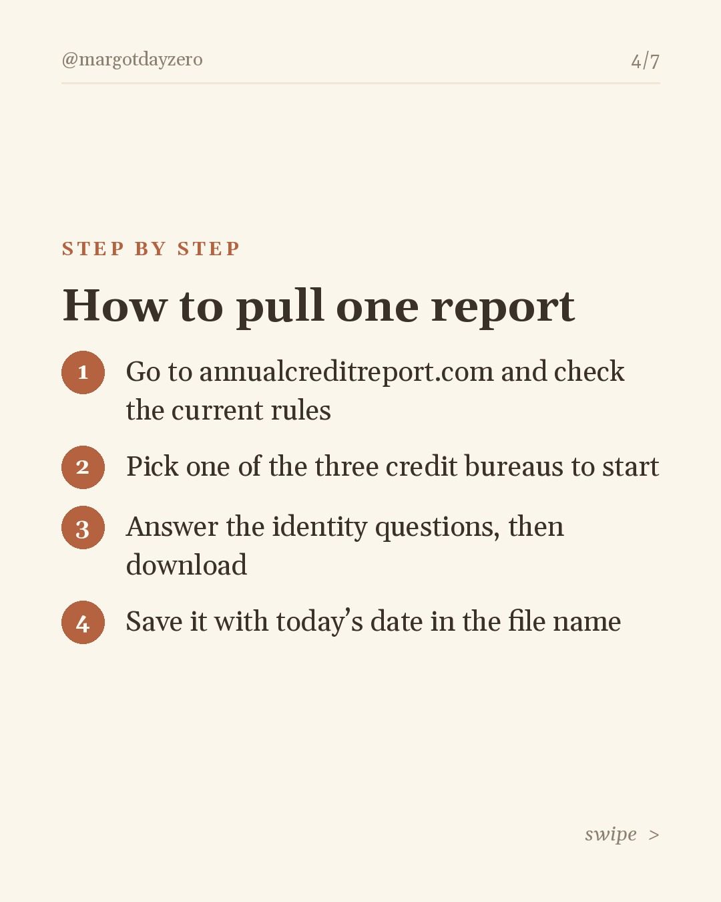
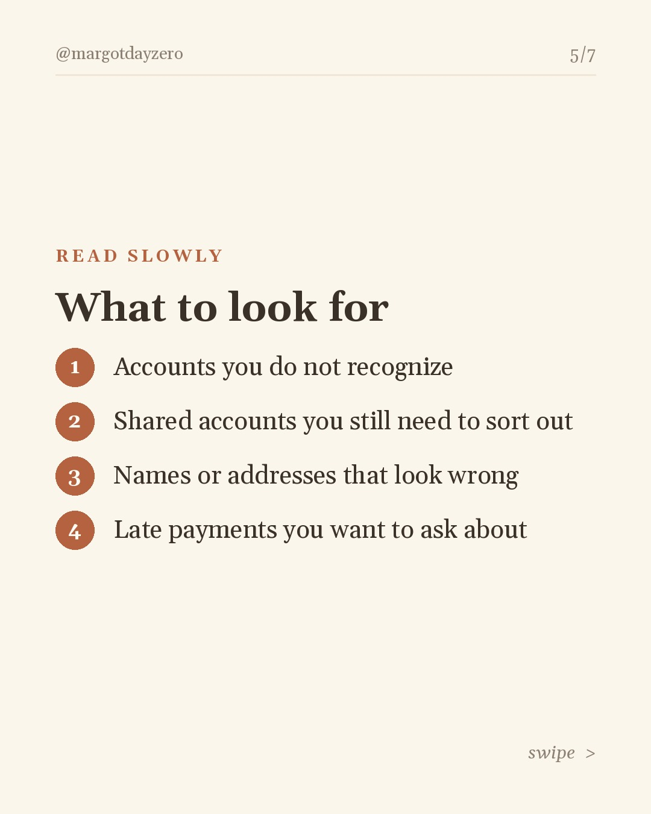
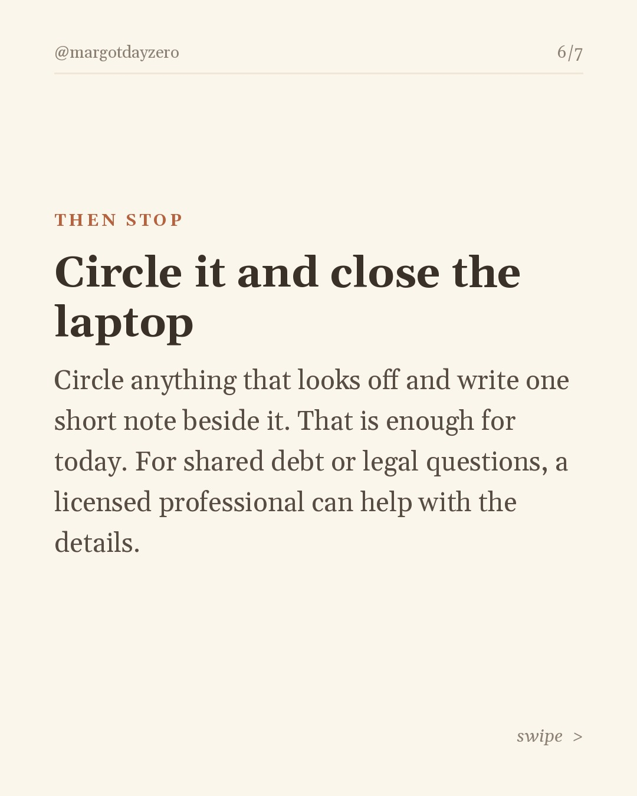
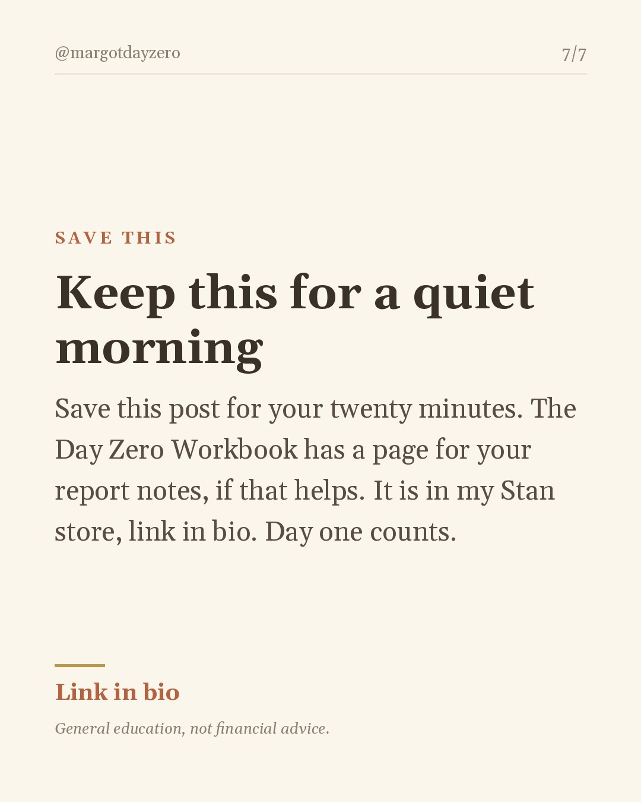

**Scheduled to post Friday, November 27 at 8 AM Eastern.**

To skip it, just **close this issue**. Do nothing and it posts automatically.

**Topic:** BUILD: a calm 20-minute first look at one credit report from one bureau, circling anything that looks off









**Caption:**

```
Your credit report is a list. You can read a list.

Pick one bureau, pull one report at annualcreditreport.com, and check the current rules while you are there.
Read it slowly with a pen nearby.
Circle anything you do not recognize, especially old shared accounts.
For bigger questions, a licensed professional can help with the details.

Save this for a quiet morning this weekend ☕
The Day Zero Workbook has a page for your report notes. Link in bio.

Day one counts.

General education, not financial advice.

#lifeafterdivorce #creditreport #startingover #moneybasics #divorcedwomen
```
