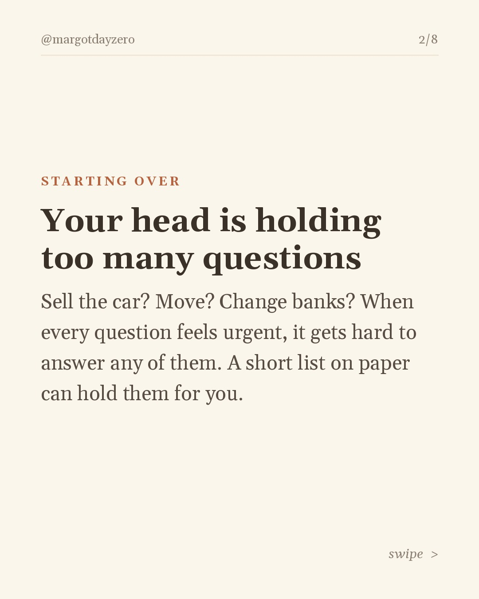
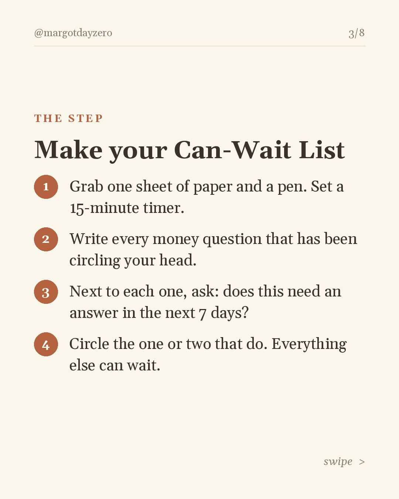
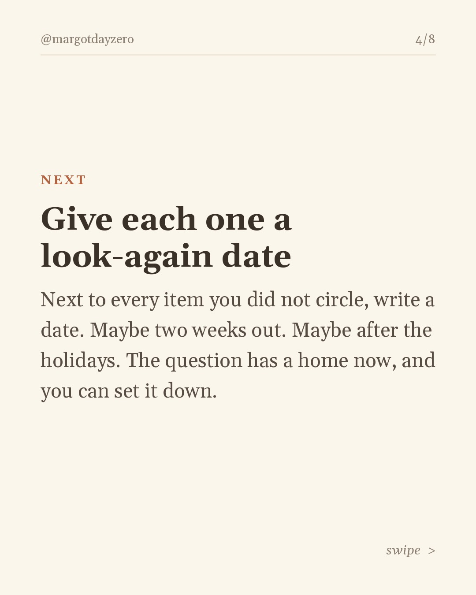
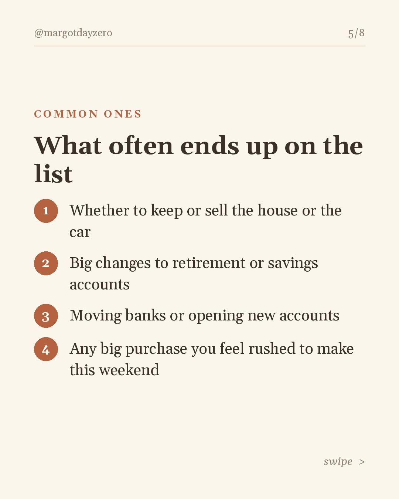
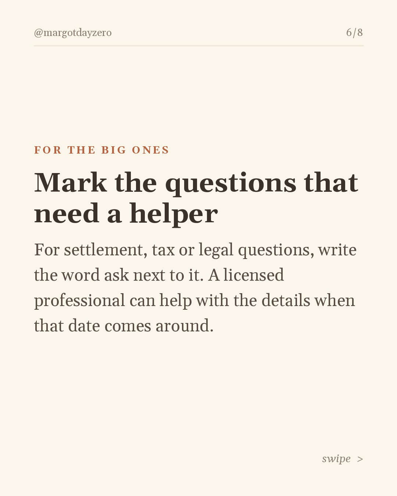
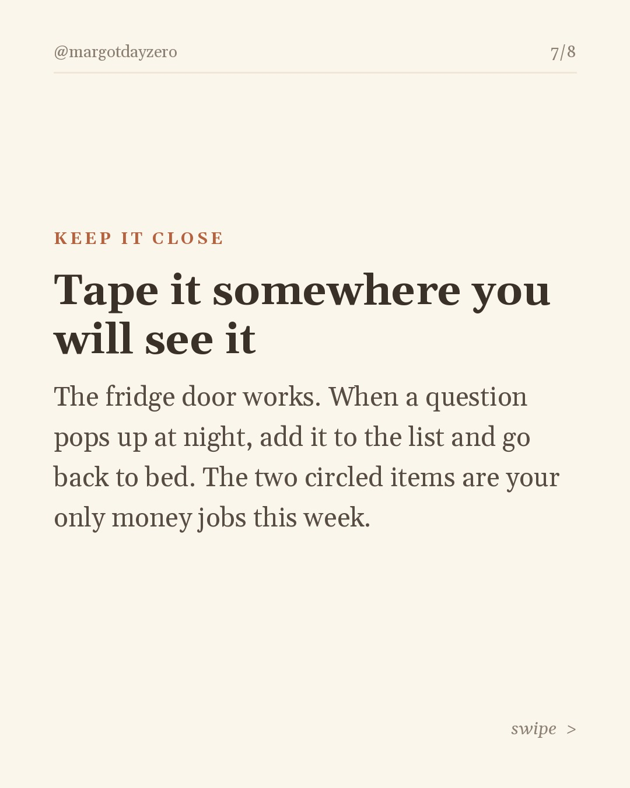
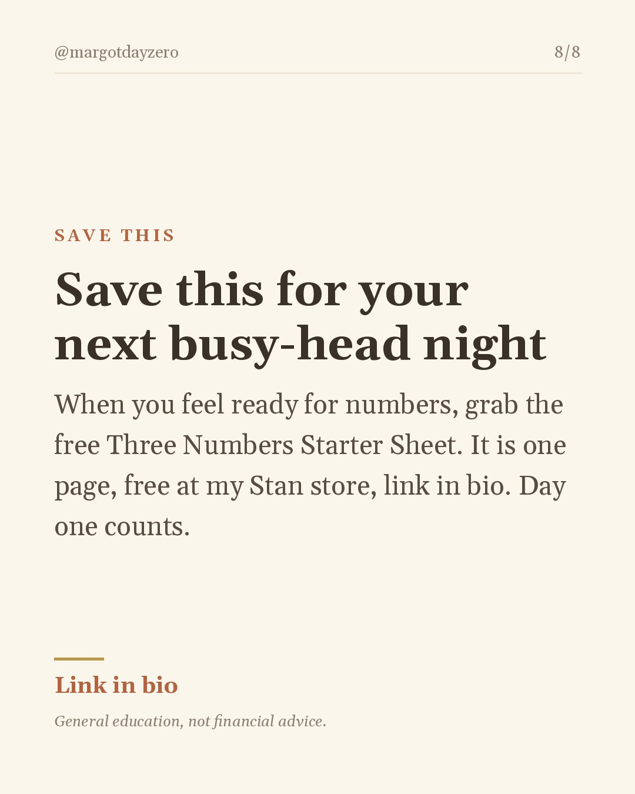

**Scheduled to post Saturday, November 28 at 8 AM Eastern.**

To skip it, just **close this issue**. Do nothing and it posts automatically.

**Topic:** STARTING OVER: a 15-minute Can-Wait List on one sheet of paper, parking money questions that do not need an answer this week and giving each a look-again date










**Caption:**

```
Some money questions can sit on a shelf for a while.
Take one sheet of paper and 15 minutes.
Write down every money question in your head, then circle the one or two that need an answer in the next seven days.
Give the rest a look-again date and let the paper hold them.
Save this for the next night your head feels crowded.
When you want to start on your numbers, the free Three Numbers Starter Sheet is one page, link in bio.
Day one counts.

General education, not financial advice.

#divorcerecovery #startingover #moneyafterdivorce #financialwellness #slowmoney
```
